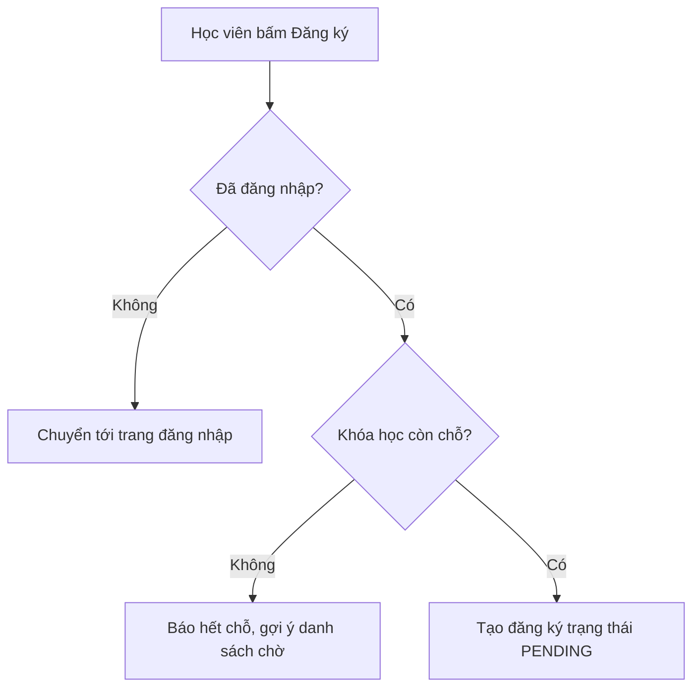
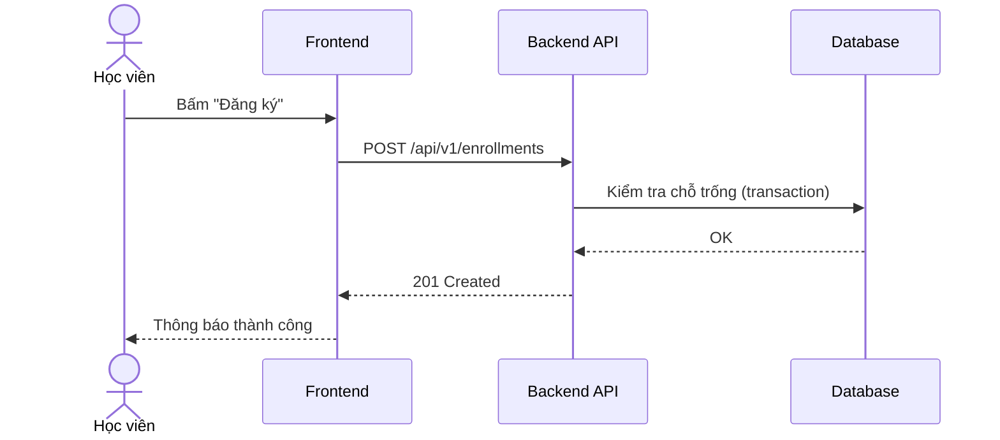
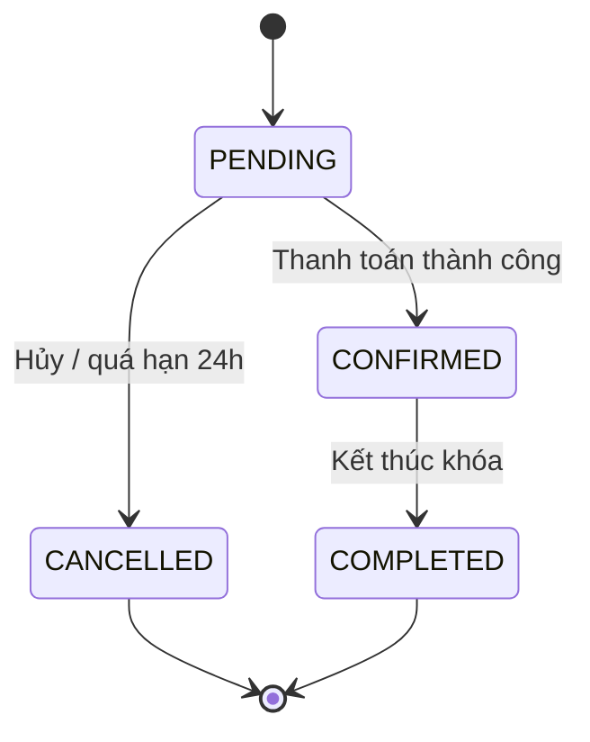

# Business Flow — Phân tích & thiết kế luồng nghiệp vụ

Mục tiêu: trước khi code, mọi người (và Claude) hiểu **ai làm gì, khi nào, theo quy tắc nào, và điều gì xảy ra khi sai**.

## 1. Quy trình phân tích

1. **Xác định actor:** ai tương tác? (Khách, Học viên, Giảng viên, Admin, Hệ thống/cron, dịch vụ ngoài)
2. **Liệt kê use case:** mỗi use case = 1 mục tiêu của 1 actor ("Học viên đăng ký khóa học").
3. **Viết luồng chính** (happy path) theo từng bước đánh số.
4. **Viết luồng thay thế & lỗi:** với *mỗi bước* hỏi "nếu sai thì sao?" — dữ liệu sai, không có quyền, hết hạn, trùng lặp, dịch vụ ngoài lỗi, người dùng hủy giữa chừng.
5. **Rút quy tắc nghiệp vụ** thành danh sách đánh mã `BR-01`, `BR-02`... — mỗi quy tắc kiểm chứng được.
6. **Thực thể & trạng thái:** thực thể nào thay đổi trạng thái? → vẽ state machine.
7. **Phân quyền:** bảng actor × hành động.
8. **Tiêu chí nghiệm thu:** dạng Given/When/Then, dùng để viết test.

## 2. Câu hỏi bắt buộc tự kiểm tra

- Dữ liệu này ai được xem / sửa / xóa?
- Xóa là xóa cứng hay xóa mềm (`deletedAt`)? Có ràng buộc dữ liệu liên quan?
- Có giới hạn số lượng, thời gian, hạn mức không?
- Thao tác có cần **idempotent** không (bấm 2 lần, gửi lại request)?
- Có xử lý đồng thời không (2 người cùng sửa, tranh chấp suất cuối cùng)?
- Có cần lưu lịch sử / audit log không?
- Có gửi thông báo (email, notification) không? Gửi đồng bộ hay bất đồng bộ?
- Tiền / điểm / số lượng: làm tròn thế nào, dùng kiểu số nào (tiền → số nguyên đơn vị nhỏ nhất hoặc Decimal)?
- Múi giờ: lưu UTC, hiển thị theo `Asia/Ho_Chi_Minh`.

Chỗ nào chưa rõ và ảnh hưởng thiết kế → ghi vào mục "Câu hỏi mở" và hỏi người dùng.

## 3. Ký hiệu sơ đồ (Mermaid)

**Luồng xử lý (flowchart):**

**Tương tác giữa các thành phần (sequence):**

**Trạng thái (state machine):**

Quy tắc state machine: mọi chuyển trạng thái **chỉ** được thực hiện ở backend service, qua một hàm kiểm tra chuyển hợp lệ; chuyển không hợp lệ → lỗi `409 INVALID_STATE_TRANSITION`.

## 4. Đầu ra

- Tạo/cập nhật file `docs/01-tong-quan/business/<feature-name>.md` theo [templates/business-spec.md](templates/business-spec.md).
- Cập nhật danh mục `docs/01-tong-quan/business/README.md` (danh sách tính năng + link).
- Mã `BR-xx` được tham chiếu lại trong code service (comment `// BR-03`) và trong tên test.

## 5. Chuyển giao cho bước tiếp theo

Từ đặc tả nghiệp vụ, rút ra cho backend:
- Thực thể & trường dữ liệu → schema CSDL
- Mỗi hành động của actor → 1 endpoint API
- Mỗi BR → 1 kiểm tra trong service + 1 test
- Mỗi luồng lỗi → 1 mã lỗi cụ thể
