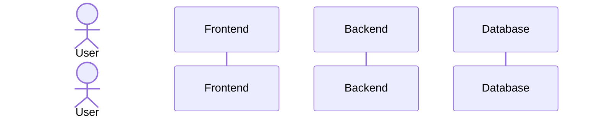
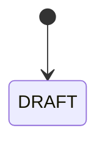

# [Tên tính năng]

> Trạng thái: Draft | Reviewed | Implemented · Cập nhật: YYYY-MM-DD

## 1. Mục tiêu
Tính năng giải quyết vấn đề gì, cho ai. (2–3 câu)

## 2. Actor
| Actor | Mô tả |
|-------|-------|
| | |

## 3. Use case
| Mã | Actor | Use case |
|----|-------|----------|
| UC-01 | | |

## 4. Luồng xử lý

### UC-01: [Tên]
**Tiền điều kiện:** ...

**Luồng chính:**
1. ...
2. ...

**Luồng thay thế / lỗi:**
- 2a. Nếu ... → ...
- 3a. Nếu ... → ...

**Hậu điều kiện:** ...

## 5. Quy tắc nghiệp vụ
| Mã | Quy tắc | Xử lý khi vi phạm (mã lỗi) |
|----|---------|----------------------------|
| BR-01 | | |

## 6. Thực thể & trạng thái
| Thực thể | Trường chính | Ghi chú |
|----------|--------------|---------|
| | | |

## 7. Phân quyền
| Hành động | Khách | User | Admin |
|-----------|:-----:|:----:|:-----:|
| | | | |

## 8. Tiêu chí nghiệm thu
- **Given** ... **When** ... **Then** ...

## 9. API liên quan
| Method | Endpoint | Mô tả |
|--------|----------|-------|
| | | |

## 10. Câu hỏi mở
- [ ] ...
