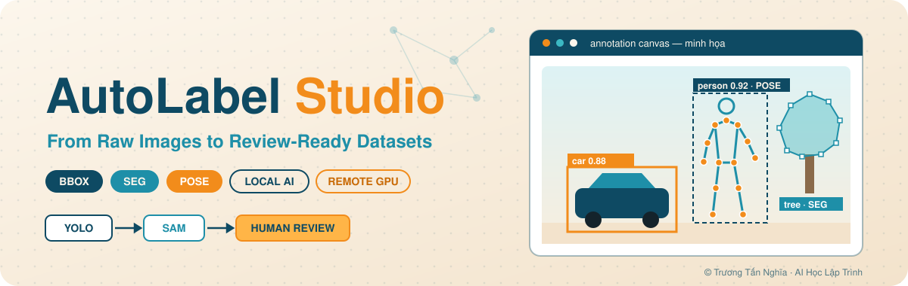
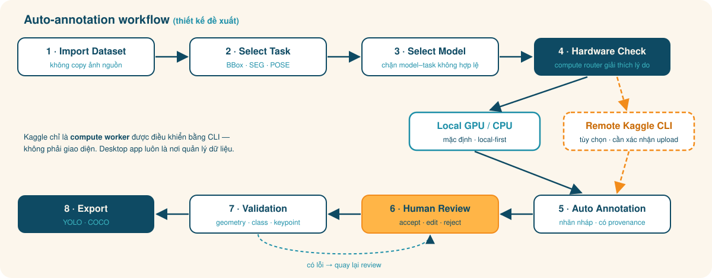
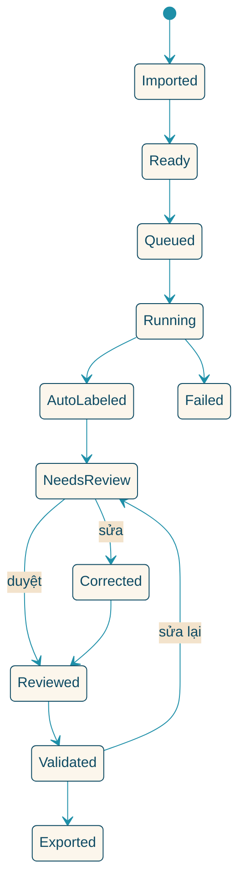
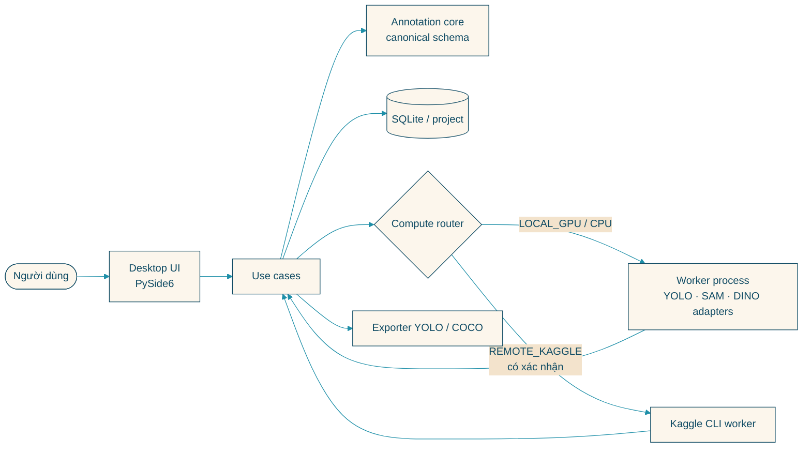
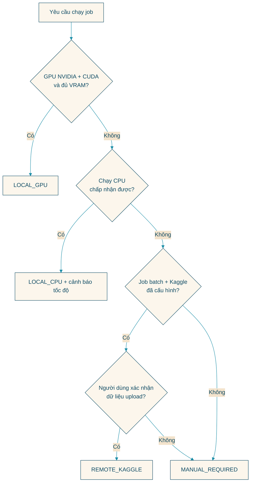
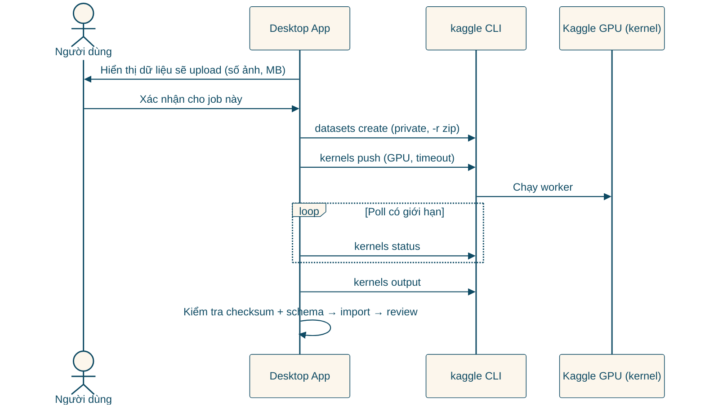

<div align="center">



# AutoLabel Studio

**Ứng dụng desktop local-first để gán nhãn dữ liệu Computer Vision bằng AI, kết hợp với người duyệt.**
*BBox · Segmentation · Pose — YOLO · SAM · DINO — chạy GPU local hoặc Kaggle GPU qua CLI*

-F28C1B?style=flat-square)
-0E4A63?style=flat-square&logo=python&logoColor=white)
-1E8FA8?style=flat-square)


</div>

> [!IMPORTANT]
> **Dự án đang ở giai đoạn thiết kế (M0 — Documentation First). Repository này chưa có source code.**
> Mọi tính năng mô tả bên dưới đều ở trạng thái **PLANNED**. Nội dung hiện có là bộ tài liệu yêu cầu, kiến trúc và lộ trình phát triển.
> Mã nguồn và tài liệu thuộc **All Rights Reserved**: được xem repository không có nghĩa là được quyền sử dụng, sao chép hay phân phối (xem [LICENSE](LICENSE)).

## Mục lục

- [Giới thiệu (About)](#giới-thiệu-about)
- [Vấn đề và mục tiêu](#vấn-đề-và-mục-tiêu)
- [Tính năng dự kiến](#tính-năng-dự-kiến)
- [Model dự kiến hỗ trợ](#model-dự-kiến-hỗ-trợ)
- [Quy trình annotation](#quy-trình-annotation)
- [Kiến trúc](#kiến-trúc)
- [Compute: local trước, Kaggle khi cần](#compute-local-trước-kaggle-khi-cần)
- [Định dạng import/export](#định-dạng-importexport)
- [Trạng thái hiện tại và cách bắt đầu](#trạng-thái-hiện-tại-và-cách-bắt-đầu)
- [Cấu trúc repository](#cấu-trúc-repository)
- [Lộ trình](#lộ-trình)
- [Hạn chế và lưu ý](#hạn-chế-và-lưu-ý)
- [Tài liệu](#tài-liệu)
- [Đóng góp](#đóng-góp)
- [License](#license)
- [Tác giả](#tác-giả)

## Giới thiệu (About)

**AutoLabel Studio** (tên tạm) là dự án xây dựng một **ứng dụng desktop** giúp đưa ảnh thô thành **dataset đã được người duyệt**, sẵn sàng để huấn luyện model Computer Vision.

| | |
|---|---|
| **Làm gì** | Quản lý dataset, tạo nhãn nháp bằng model pretrained (YOLO, SAM 2…), cho người chỉnh sửa/duyệt, kiểm tra chất lượng, rồi export YOLO/COCO |
| **Cho ai** | Kỹ sư/nhà nghiên cứu CV, người gán nhãn, học viên có máy yếu |
| **Khác biệt** | *Local-first* (dữ liệu ở máy bạn) · nhãn AI **không bao giờ** được coi là ground truth nếu chưa duyệt · mọi nhãn đều có nguồn gốc (provenance) · router tự chọn GPU/CPU và **giải thích lý do** · Kaggle GPU chỉ được dùng khi bạn xác nhận |
| **Trạng thái** | Giai đoạn thiết kế: đã có bộ tài liệu 00–19 cùng lộ trình 7 bước; chưa có code |
| **Phương pháp** | *Vibe coding có kỷ luật*: phát triển cùng AI (Claude Code), dựa trên bộ skills, tài liệu là nguồn sự thật, có cổng duyệt giữa các bước |

## Vấn đề và mục tiêu

| Vấn đề | Hướng giải quyết |
|---|---|
| Gán nhãn BBox/SEG/POSE thủ công rất chậm | Auto-label bằng model pretrained, con người chỉ cần sửa và duyệt |
| Công cụ cloud bắt upload dữ liệu | Dữ liệu ở máy local; chỉ gửi đi khi người dùng chủ động xác nhận cho từng job |
| Máy không có GPU | Compute router: GPU local → CPU → Kaggle GPU qua CLI |
| Nhãn model bị coi là "đúng" | Tách biệt rõ *auto-generated* và *human-verified* |
| Mất thông tin khi đổi format | Canonical schema, adapter cho từng format, round-trip test |

## Tính năng dự kiến

| Nhóm | Tính năng | Trạng thái |
|---|---|:-:|
| **Dataset** | Import thư mục (không copy ảnh), thumbnail, bộ lọc, relink, thống kê | PLANNED · MVP |
| **BBox** | Vẽ/sửa box, phím tắt, undo/redo, autosave | PLANNED · MVP |
| **Segmentation** | Polygon nhiều mảnh, mask overlay, SAM-assisted (click/box) | PLANNED · MVP |
| **Pose** | Keypoints + skeleton, visibility, preset COCO-17 | PLANNED · MVP |
| **AI Auto-label** | Chạy batch, class mapping, merge an toàn (không ghi đè nhãn đã duyệt) | PLANNED · MVP |
| **Human review** | Review queue, accept/edit/reject, duyệt hàng loạt theo ngưỡng | PLANNED · MVP |
| **Dataset validation** | Kiểm tra geometry, class, keypoint, review coverage; preflight trước khi export | PLANNED · MVP |
| **Import/Export** | YOLO, COCO (kèm manifest) | PLANNED · MVP |
| **Compute** | Phát hiện GPU/VRAM, router local GPU/CPU, xử lý OOM | PLANNED · MVP |
| **Remote** | Kaggle GPU qua CLI, consent theo job, resume theo chunk | PLANNED · MVP (có giới hạn) |
| **Mở rộng** | SAM 3 (prompt văn bản), DINOv2 (ảnh tương tự/trùng), Pascal VOC | PLANNED · V1 |

Chưa có ảnh chụp màn hình, vì ứng dụng chưa được xây dựng. Ảnh banner ở trên chỉ là **artwork minh họa**, không phải ảnh chụp sản phẩm.

## Model dự kiến hỗ trợ

| Model | Vai trò trong sản phẩm | License (xác minh 2026-11-24) | Trạng thái |
|---|---|---|:-:|
| YOLO Detection (YOLO26/YOLO11) | Sinh BBox | AGPL-3.0 ⚠️ | PLANNED, **chờ quyết định license** |
| YOLO Segmentation | Sinh mask/polygon | AGPL-3.0 ⚠️ | PLANNED, chờ quyết định license |
| YOLO Pose | Sinh keypoints | AGPL-3.0 ⚠️ | PLANNED, chờ quyết định license |
| SAM 2 / 2.1 | Tinh chỉnh mask từ point/box; pipeline YOLO → SAM 2 | Apache 2.0 | PLANNED · MVP |
| SAM 3 | Segment theo khái niệm bằng text prompt | SAM License (tùy chỉnh, gated) | PLANNED · V1 (có điều kiện) |
| DINOv2 | **Embedding**: tìm ảnh tương tự, near-duplicate (không phải detector) | Apache 2.0 | PLANNED · V1 |
| DINOv3 | Embedding | DINOv3 License (tùy chỉnh, gated) | Future |

Mỗi model có vai trò khác nhau và đi qua **adapter theo task**; ứng dụng chặn tổ hợp model–task không hợp lệ. SAM chỉ sinh mask, **không** tự sinh tên class. Chi tiết: [docs/02-kien-truc/05_model_and_inference_design.md](docs/02-kien-truc/05_model_and_inference_design.md).

## Quy trình annotation



Trạng thái của ảnh *(thiết kế đề xuất)*:



## Kiến trúc

*(PROPOSED: chưa được hiện thực)*



- **Model chạy trong worker process riêng**: UI không bao giờ bị treo, và model crash cũng không kéo sập app.
- **Một gói worker** dùng chung cho cả máy local và Kaggle, nên kết quả nhất quán.
- **SQLite cho mỗi project**; ảnh nguồn được đọc ở chế độ chỉ đọc và không bị copy.

Chi tiết: [docs/02-kien-truc/04_system_architecture.md](docs/02-kien-truc/04_system_architecture.md) · ADR: [docs/02-kien-truc/18_architecture_decision_records.md](docs/02-kien-truc/18_architecture_decision_records.md).

## Compute: local trước, Kaggle khi cần





- Kaggle là **compute worker**, không phải giao diện; không cần mở trình duyệt khi chạy job.
- Token Kaggle do Kaggle CLI quản lý (`KAGGLE_API_TOKEN` hoặc file chuẩn). App **không** lưu token, và không ghi token vào log hay README.
- CLI **không có lệnh dừng** kernel đang chạy, nên mỗi job luôn được đặt `timeout`.

Chi tiết: [docs/02-kien-truc/08_hardware_and_compute_routing.md](docs/02-kien-truc/08_hardware_and_compute_routing.md) · [docs/02-kien-truc/09_kaggle_remote_worker.md](docs/02-kien-truc/09_kaggle_remote_worker.md).

## Định dạng import/export

| Format | Task | Trạng thái |
|---|---|:-:|
| YOLO | detect · segment · pose (`data.yaml`, `kpt_shape`, `flip_idx`) | PLANNED · MVP |
| COCO | detection · instances (polygon/RLE) · keypoints | PLANNED · MVP |
| Pascal VOC | detection | PLANNED · V1 |

Mỗi lần export có manifest và báo cáo những chuyển đổi bị mất thông tin. Mặc định chỉ export các nhãn đã được duyệt. Chi tiết: [docs/03-du-lieu/07_dataset_and_import_export.md](docs/03-du-lieu/07_dataset_and_import_export.md).

## Trạng thái hiện tại và cách bắt đầu

Chưa có ứng dụng để cài đặt hay chạy, và chưa có test.

| Việc bạn có thể làm ngay | Ở đâu |
|---|---|
| Đọc tổng quan, phạm vi MVP và 5 câu hỏi mở | [docs/01-tong-quan/00_project_overview.md](docs/01-tong-quan/00_project_overview.md) |
| Xem mục lục toàn bộ tài liệu | [docs/README.md](docs/README.md) |
| Xem lộ trình 7 bước (master prompts) | [docs/steps/README.md](docs/steps/README.md) |
| Xem kế hoạch môi trường (Python 3.12, PyTorch theo driver, uv) | [docs/05-phat-trien/11_environment_and_setup.md](docs/05-phat-trien/11_environment_and_setup.md) |
| Phát triển cùng Claude Code | Mở repo bằng Claude Code: `CLAUDE.md` bắt buộc đọc bộ skills trong `.claude/skills/` trước khi làm |

**Cấu hình model weights và Kaggle CLI** sẽ được hướng dẫn khi tính năng được hiện thực (M5, M8). Thiết kế hiện tại: weights chỉ được tải khi người dùng bấm tải, có kiểm tra checksum; Kaggle CLI cài riêng (`kaggle>=2.2.5`) và là thành phần **tùy chọn**.

## Cấu trúc repository

```
.
├── README.md · LICENSE · THIRD_PARTY_NOTICES.md · CLAUDE.md
├── assets/                  # banner.svg, workflow.svg, signature.svg
├── .claude/
│   ├── settings.json        # Hook nhắc đọc skills khi mở phiên
│   └── skills/              # project-workflow, business-flow, backend-api, frontend-ui, tech-docs, quality-gate
└── docs/
    ├── README.md            # Mục lục tài liệu
    ├── steps/               # 7 master prompt theo thứ tự thực hiện
    ├── 01-tong-quan/        # Overview, requirements, feasibility, research
    ├── 02-kien-truc/        # Architecture, model, compute, Kaggle, ADR
    ├── 03-du-lieu/          # Annotation data model, dataset & import/export
    ├── 04-giao-dien/        # UI/UX specification
    ├── 05-phat-trien/       # Environment, codebase structure, testing
    ├── 06-ke-hoach/         # Roadmap, readiness checklist
    └── 07-van-hanh/         # Packaging, security & licenses, troubleshooting
```

Source code (dự kiến) sẽ là một uv workspace gồm `packages/core`, `packages/app`, `packages/worker`, xem [docs/05-phat-trien/12_codebase_structure.md](docs/05-phat-trien/12_codebase_structure.md).

## Lộ trình

| Milestone | Nội dung | Trạng thái |
|---|---|:-:|
| M0 | Requirements, research, architecture | **IN PROGRESS** (Bước 01 xong) |
| M1–M2 | Desktop shell; project/dataset | NOT STARTED |
| M3–M4 | Annotation core; BBox, SEG, POSE | NOT STARTED |
| M5 | Model registry + YOLO local | **BLOCKED** (quyết định license) |
| M6–M7 | SAM 2; hardware router | NOT STARTED |
| M8 | Kaggle CLI remote | **BLOCKED** (đánh giá điều khoản Kaggle) |
| M9–M10 | Review/validation/export; packaging | NOT STARTED |

Chi tiết: [docs/06-ke-hoach/13_implementation_roadmap.md](docs/06-ke-hoach/13_implementation_roadmap.md).

## Hạn chế và lưu ý

- **License YOLO:** `ultralytics` và weights YOLO dùng AGPL-3.0, trong khi sản phẩm closed-source cần Enterprise License. Chưa có quyết định, xem [docs/07-van-hanh/16_security_privacy_and_licenses.md](docs/07-van-hanh/16_security_privacy_and_licenses.md).
- **Kaggle:** quota GPU và thời gian phiên không được đảm bảo, và có thể thay đổi; điều khoản sử dụng cần được xem xét. Dữ liệu chỉ được gửi đi khi người dùng chủ động cấu hình và xác nhận.
- **Không có benchmark:** mọi số liệu hiệu năng chỉ được công bố sau khi đo thật.
- **SAM 3 / DINOv3** cần xin quyền truy cập (gated) và có license tùy chỉnh; SAM 3 cần GPU CUDA ≥ 12.6.

## Tài liệu

Mục lục đầy đủ: **[docs/README.md](docs/README.md)**. Một số tài liệu chính:
[Overview](docs/01-tong-quan/00_project_overview.md) ·
[Requirements](docs/01-tong-quan/01_requirements.md) ·
[Research](docs/01-tong-quan/03_research_and_references.md) ·
[Architecture](docs/02-kien-truc/04_system_architecture.md) ·
[Annotation Data Model](docs/03-du-lieu/06_annotation_data_model.md) ·
[UI/UX](docs/04-giao-dien/10_desktop_ui_ux_specification.md) ·
[Testing](docs/05-phat-trien/14_testing_and_quality_strategy.md) ·
[Troubleshooting](docs/07-van-hanh/17_troubleshooting.md)

## Đóng góp

Đây là dự án **All Rights Reserved** và chưa nhận đóng góp công khai. Nếu bạn muốn trao đổi hoặc hợp tác, hãy liên hệ tác giả qua các kênh bên dưới. Mọi đóng góp chỉ được nhận khi có thỏa thuận bằng văn bản.

## License

**All Rights Reserved** © 2026 Trương Tấn Nghĩa. Xem [LICENSE](LICENSE) (song ngữ Việt–Anh).
License này **không** bao trùm thư viện và model của bên thứ ba; xem [THIRD_PARTY_NOTICES.md](THIRD_PARTY_NOTICES.md).

## Tác giả

<div align="center">


**Trương Tấn Nghĩa** · **AI Học Lập Trình**
🔥 Never give up 🔥

[GitHub](https://github.com/TruongTanNghia) · [Portfolio](https://nghia-dev-profile.vercel.app) · [TikTok](https://www.tiktok.com/@aihoclaptrinh)

</div>
