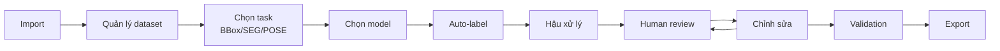

# 00 — Project Overview

> Tài liệu nền: tầm nhìn, phạm vi, MVP và tiêu chí thành công của AutoLabel Studio.
> Trạng thái: **Draft — chờ chủ dự án duyệt** · Cập nhật: 2026-11-24 · Giai đoạn: M0 (Documentation First, chưa có source code)

Nhãn sử dụng trong toàn bộ bộ tài liệu:
**CONFIRMED** = đã xác minh từ nguồn chính thức / yêu cầu đã chốt · **ASSUMPTION** = giả định để tiếp tục, cần xác nhận · **PROPOSAL** = đề xuất kỹ thuật, chờ duyệt · **UNVERIFIED** = chưa kiểm chứng được.

## 1. Tầm nhìn

**AutoLabel Studio** (tên tạm) là ứng dụng desktop **local-first** giúp đi từ ảnh thô đến dataset Computer Vision đã được người duyệt, sẵn sàng để huấn luyện. Ứng dụng tận dụng model pretrained (YOLO, SAM, DINO) để tạo nhãn nháp, còn con người luôn là người xác nhận cuối cùng.

> *From Raw Images to Review-Ready Datasets.*

## 2. Vấn đề cần giải quyết

| Vấn đề | Hệ quả hiện tại | AutoLabel Studio giải quyết bằng |
|---|---|---|
| Gán nhãn thủ công BBox/SEG/POSE rất chậm | Chi phí dataset cao, chậm ra model | Auto-label bằng model pretrained + chỉnh sửa nhanh |
| Công cụ web/cloud yêu cầu upload dữ liệu | Rủi ro quyền riêng tư, phụ thuộc mạng | Dữ liệu ở máy local; chỉ gửi đi khi người dùng chủ động chọn |
| Máy cá nhân thiếu GPU | Không chạy nổi model lớn | Compute router: local GPU → local CPU → Kaggle GPU qua CLI |
| Kết quả model bị coi là "đúng" | Dataset nhiễu, khó truy vết | Phân biệt *auto-generated* và *human-verified*, có provenance |
| Mỗi công cụ một format | Mất thông tin khi chuyển đổi | Canonical schema + adapter riêng cho từng format, có round-trip test |

## 3. Người dùng mục tiêu

| Persona | Mô tả | Nhu cầu chính |
|---|---|---|
| **P1 — CV Engineer / Researcher** | Huấn luyện model detect/seg/pose, dataset 1k–100k ảnh | Auto-label theo batch, export YOLO/COCO chuẩn, kiểm soát chất lượng |
| **P2 — Annotator** | Chỉnh sửa và duyệt nhãn hằng ngày | Canvas mượt, phím tắt, review queue, không mất dữ liệu |
| **P3 — Học viên / Người mới** | Học CV, máy yếu hoặc không có GPU | Cài đặt đơn giản, chạy được trên CPU, dùng Kaggle GPU miễn phí khi cần |

MVP là ứng dụng **single-user, single-machine** (ASSUMPTION A-01).

## 4. Phạm vi

### 4.1 Vòng đời annotation

### 4.2 Phân tầng phạm vi

| Nhóm | MVP | V1 | Future |
|---|---|---|---|
| Project & Dataset | Tạo/mở/đóng project; import folder lồng nhau; thumbnail cache; metadata store; quản lý class; integrity check; thống kê cơ bản | Duplicate detection theo hash; quản lý split train/val/test; relink hàng loạt | Đồng bộ nhiều máy |
| Annotation | BBox, Polygon (instance SEG), Keypoints + skeleton; undo/redo; phím tắt; autosave | Brush/eraser mask; polygon có lỗ (holes) trên UI; keypoint schema editor nâng cao | OBB, classification, semantic SEG, video & tracking |
| AI Auto-label | YOLO detect/segment/pose; SAM 2 tinh chỉnh mask (prompt box/point); pipeline YOLO → SAM 2 | SAM 3 (prompt văn bản theo khái niệm) **nếu license/quyền truy cập phù hợp**; DINOv2 embedding (similarity, near-duplicate) | DINOv3; active learning; fine-tune model |
| Compute | Hardware probe; LOCAL_GPU / LOCAL_CPU; router có giải thích; OOM handling; **Kaggle CLI remote cho batch job** | Remote profile nâng cao; chunking/resume tối ưu | SSH worker, provider khác |
| QA | Kiểm tra geometry, class, keypoint, review coverage; export preflight | Cảnh báo chồng lấn/trùng nhãn; báo cáo phân bố class | Gợi ý lỗi nhãn bằng model |
| Import/Export | YOLO detect/seg/pose; COCO detection/instances/keypoints | Pascal VOC (detection) | Format khác theo nhu cầu |
| Packaging | Chạy từ source (dev); bản portable Windows ở cuối MVP | Installer Windows; Linux chính thức | macOS; auto-update |

### 4.3 Non-goals (không làm)

- Không phải nền tảng cloud hay web app; không có server backend trung tâm trong MVP.
- Không huấn luyện model mới trong MVP; ưu tiên inference từ checkpoint pretrained.
- Không làm giao diện điều khiển Kaggle trên web. Kaggle chỉ là compute worker được điều khiển bằng CLI.
- Không có tính năng cộng tác nhiều người dùng hay phân quyền trong MVP.
- Không tự động coi kết quả model là ground truth.
- Không tạo định dạng annotation độc quyền khóa người dùng.

## 5. Đường đi MVP ngắn nhất

1. **MVP-α (lát cắt dọc đầu tiên):** shell desktop → tạo project → import ảnh → vẽ BBox → YOLO detect chạy local → review → export YOLO detect. Mục đích là chứng minh toàn bộ kiến trúc (UI ↔ core ↔ worker process ↔ SQLite ↔ exporter) càng sớm càng tốt.
2. **MVP-β:** thêm SEG (polygon), POSE, SAM 2 refinement, COCO import/export, validation đầy đủ.
3. **MVP (v0.1):** thêm hardware router hoàn chỉnh, Kaggle remote batch, crash recovery, bản portable Windows.

Chi tiết milestone xem [13_implementation_roadmap.md](../06-ke-hoach/13_implementation_roadmap.md).

## 6. Tiêu chí thành công (PROPOSAL, cần đo thực tế)

| Mã | Tiêu chí | Cách đo |
|---|---|---|
| SC-01 | Hoàn thành end-to-end import → auto-label → review → export cho cả 3 task | Kịch bản E2E tự động trên dataset mẫu |
| SC-02 | UI không bị treo khi inference: không có tác vụ nào chặn UI thread quá 100 ms | Đo bằng watchdog event-loop trong test UI |
| SC-03 | Không mất annotation khi app bị kill: mất tối đa các thay đổi trong khoảng debounce autosave (mục tiêu ≤ 2 s) | Test kill process trong lúc chỉnh sửa |
| SC-04 | Round-trip YOLO/COCO không mất thông tin với các trường được hỗ trợ | Bộ test round-trip, so sánh canonical trước/sau |
| SC-05 | Không gửi dữ liệu ra ngoài nếu người dùng chưa xác nhận | Test luồng remote + kiểm tra log mạng |
| SC-06 | Router luôn nêu lý do chọn chế độ chạy (local/remote/manual) | Unit test router + kiểm tra UI |
| SC-07 | Giảm thời gian gán nhãn so với làm thủ công | Đo thời gian/ảnh có và không có auto-label trên cùng dataset (chưa đặt chỉ tiêu, không bịa số) |

## 7. Giả định đang dùng (cần chủ dự án xác nhận)

| Mã | Giả định | Ảnh hưởng nếu sai |
|---|---|---|
| A-01 | Single-user, một máy, project lưu local | Multi-user → cần server, PostgreSQL, khóa/version |
| A-02 | Windows 10/11 x64 là ưu tiên; Linux (Ubuntu 22.04+) best-effort; macOS để roadmap | Hỗ trợ macOS sớm → đổi chiến lược GPU (MPS), packaging |
| A-03 | MVP chỉ xử lý ảnh tĩnh (JPEG, PNG, BMP, TIFF, WebP); video để Future | Video trong MVP → thêm frame extraction, tracking, schema frame |
| A-04 | Quy mô thiết kế: ≤ 50.000 ảnh/project cho MVP, kiến trúc không chặn 200.000 (ESTIMATE, phải benchmark) | Lớn hơn → cần thay đổi chiến lược index, thumbnail, DB |
| A-05 | Format bắt buộc MVP: YOLO (detect/seg/pose) và COCO (detection/instances/keypoints) | Thêm format → thêm adapter và test |
| A-06 | Máy phát triển là Windows; có thể có hoặc không có GPU NVIDIA; app phải chạy được ở chế độ CPU-only | Router và profile mặc định |
| A-07 | Kaggle là remote provider duy nhất trong MVP, nhưng kiến trúc qua provider interface | Thêm provider → thêm adapter |
| A-08 | Ngôn ngữ chính là Python; UI bằng PySide6 (PROPOSAL, xem ADR-001) | Đổi framework → ảnh hưởng toàn bộ tầng UI |
| A-09 | Sản phẩm có thể phân phối dạng closed-source ("All Rights Reserved") | **Xung đột license với Ultralytics AGPL-3.0**, xem [16](../07-van-hanh/16_security_privacy_and_licenses.md) |

## 8. Câu hỏi cần chủ dự án chốt (tối đa 5, ảnh hưởng lớn tới kiến trúc)

1. **Mô hình phân phối & license:** sản phẩm sẽ là closed-source/thương mại, nội bộ/học tập, hay open-source? (Ultralytics YOLO dùng AGPL-3.0, nên đây là quyết định chặn).
2. **Phần cứng mục tiêu:** máy phát triển và máy người dùng điển hình có GPU NVIDIA không, bao nhiêu VRAM?
3. **Quy mô dataset:** số ảnh/project và độ phân giải điển hình, có ảnh rất lớn (> 8K, ảnh vệ tinh) không?
4. **Video annotation:** có bắt buộc trong MVP không? (đang giả định là không)
5. **Kaggle:** bạn đã có tài khoản Kaggle đã xác minh số điện thoại (điều kiện để dùng GPU) chưa? Kaggle là provider duy nhất hay chỉ là provider đầu tiên?

## 9. Bản đồ tài liệu

| # | Tài liệu | Nội dung |
|---|---|---|
| 00 | [Project Overview](00_project_overview.md) | Tầm nhìn, phạm vi, MVP |
| 01 | [Requirements](01_requirements.md) | User story, FR/NFR, acceptance |
| 02 | [Feasibility Study](02_feasibility_study.md) | Tính khả thi, rủi ro |
| 03 | [Research & References](03_research_and_references.md) | Model, framework, license, nguồn |
| 04 | [System Architecture](../02-kien-truc/04_system_architecture.md) | Thành phần, luồng, state machine |
| 05 | [Model & Inference Design](../02-kien-truc/05_model_and_inference_design.md) | Registry, adapter, pipeline |
| 06 | [Annotation Data Model](../03-du-lieu/06_annotation_data_model.md) | Canonical schema |
| 07 | [Dataset & Import/Export](../03-du-lieu/07_dataset_and_import_export.md) | Import, format, round-trip |
| 08 | [Hardware & Compute Routing](../02-kien-truc/08_hardware_and_compute_routing.md) | Probe, router, OOM |
| 09 | [Kaggle Remote Worker](../02-kien-truc/09_kaggle_remote_worker.md) | CLI workflow, bảo mật, giới hạn |
| 10 | [Desktop UI/UX Specification](../04-giao-dien/10_desktop_ui_ux_specification.md) | Màn hình, phím tắt, trạng thái |
| 11 | [Environment & Setup](../05-phat-trien/11_environment_and_setup.md) | Dependency, CUDA, setup |
| 12 | [Codebase Structure](../05-phat-trien/12_codebase_structure.md) | Cấu trúc module |
| 13 | [Implementation Roadmap](../06-ke-hoach/13_implementation_roadmap.md) | Milestone, DoD |
| 14 | [Testing & Quality Strategy](../05-phat-trien/14_testing_and_quality_strategy.md) | Chiến lược test |
| 15 | [Packaging, Release & Operations](../07-van-hanh/15_packaging_release_and_operations.md) | Đóng gói, vận hành |
| 16 | [Security, Privacy & Licenses](../07-van-hanh/16_security_privacy_and_licenses.md) | Bảo mật, license |
| 17 | [Troubleshooting](../07-van-hanh/17_troubleshooting.md) | Xử lý sự cố |
| 18 | [Architecture Decision Records](../02-kien-truc/18_architecture_decision_records.md) | ADR |
| 19 | [Project Readiness Checklist](../06-ke-hoach/19_project_readiness_checklist.md) | Checklist sẵn sàng |
