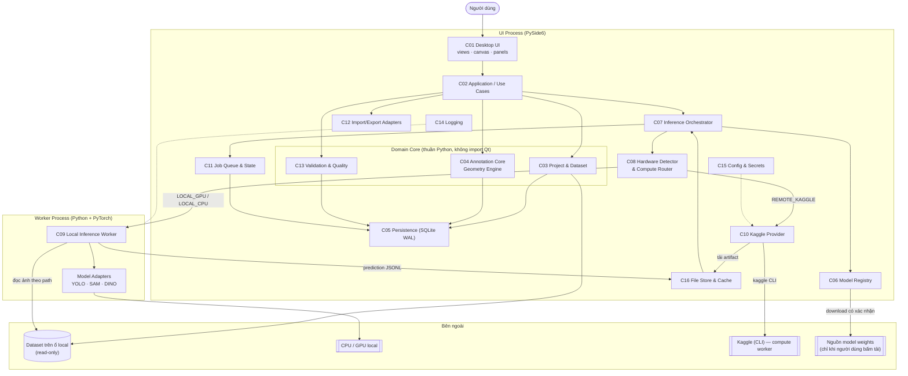
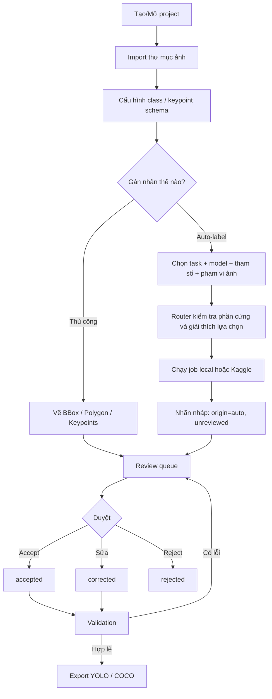
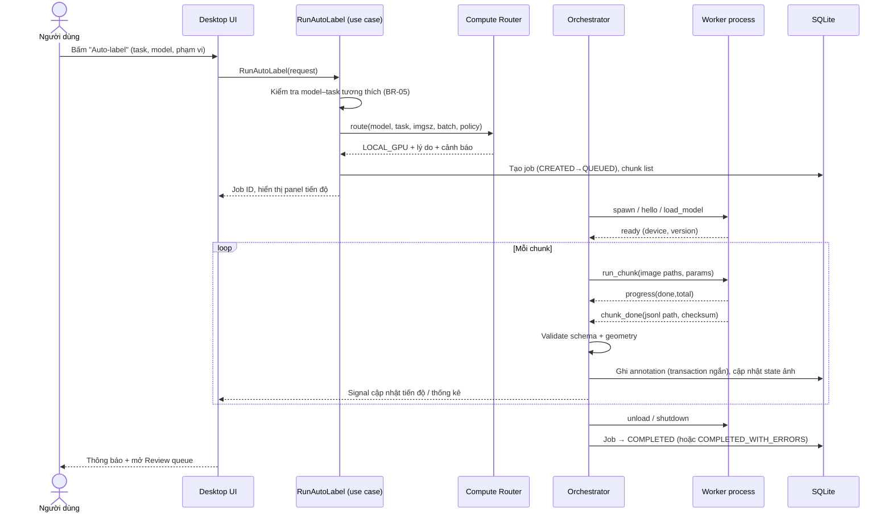
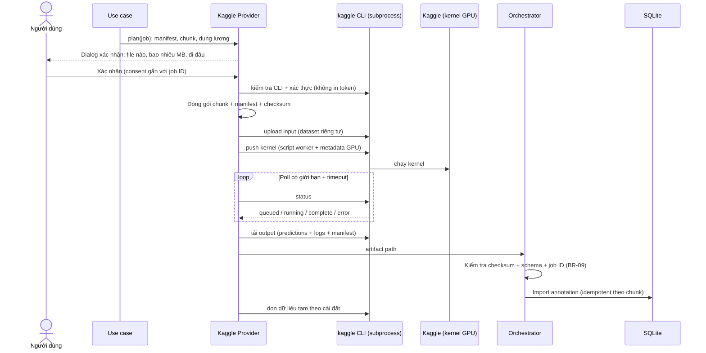
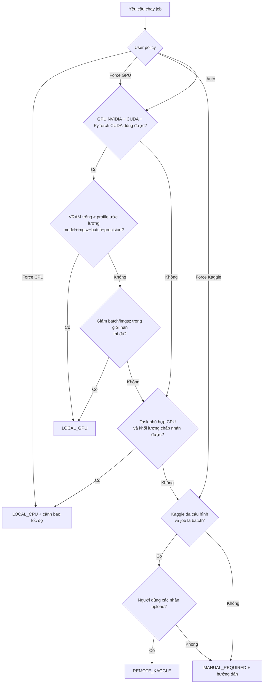
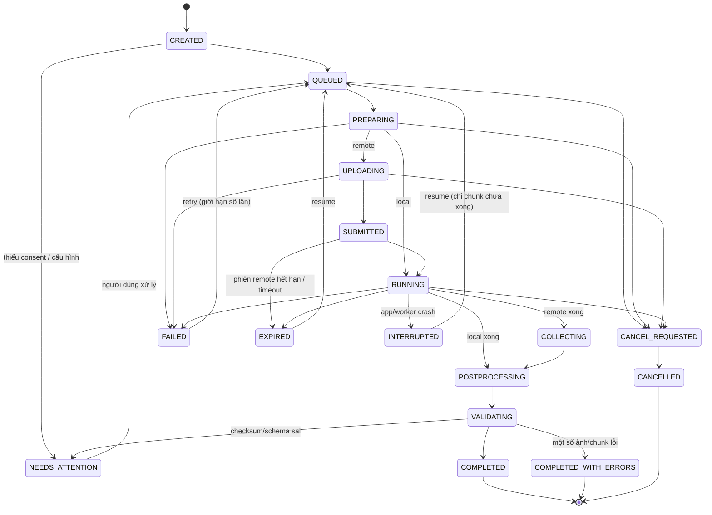

# 04 — System Architecture

> Kiến trúc tổng thể: các tầng, thành phần, mô hình tiến trình, luồng dữ liệu, state machine và xử lý lỗi.
> Trạng thái: **PROPOSAL** (greenfield, mọi thành phần đều ở trạng thái Proposed) · Cập nhật: 2026-11-24
> Sơ đồ chi tiết hơn (16 sơ đồ) sẽ được làm ở Bước 02 → `docs/02-kien-truc/architecture/`.

## 1. Định hướng kiến trúc

| Định hướng | Quyết định | ADR |
|---|---|---|
| Kiểu kiến trúc | **Modular monolith** desktop + **tiến trình worker** cho inference | ADR-003 |
| Phân tầng | UI → Application (use case) → Domain core ← Infrastructure (ports & adapters) | ADR-002 |
| UI framework | PySide6 (Qt 6), canvas bằng `QGraphicsView` | ADR-001 |
| Lưu trữ | SQLite (WAL) cho mỗi project + filesystem cho file lớn; **chỉ tiến trình chính ghi DB** | ADR-004 |
| Inference | Worker process riêng; giao tiếp bằng JSON-lines; dữ liệu truyền qua **đường dẫn file**, không truyền pixel qua pipe | ADR-003 |
| Remote | Cùng một gói worker chạy được ở local và trên Kaggle; Kaggle chỉ là provider | ADR-006 |
| Model | Registry + adapter theo task; output được chuẩn hóa về canonical schema | ADR-005 |

## 2. Thành phần

| ID | Thành phần | Tầng | Trách nhiệm | Chạy ở |
|---|---|---|---|---|
| C01 | Desktop UI Layer | UI | Màn hình, canvas, panel, dialog; chỉ gọi use case, không chứa logic nghiệp vụ | UI process (main thread) |
| C02 | Application / Use Case Layer | Application | Điều phối use case (`CreateProject`, `ImportDataset`, `RunAutoLabel`, `ReviewAnnotations`, `ExportDataset`…), transaction, phát domain event | UI process (background thread khi tác vụ nặng) |
| C03 | Project & Dataset Service | Domain | Vòng đời project, quét/index dataset, relink, thống kê | UI process |
| C04 | Annotation Core / Geometry Engine | Domain | Canonical model, phép biến đổi tọa độ, mask↔polygon, chuyển trạng thái | Dùng chung (thư viện thuần Python) |
| C05 | Annotation Persistence | Infrastructure | Repository SQLite, autosave, migration, backup | UI process (writer duy nhất) |
| C06 | Model Registry & Model Adapters | Inference | Mô tả model/checkpoint/capability; adapter load/infer/normalize | Registry ở UI process; adapter ở worker |
| C07 | Inference Orchestrator | Inference | Tạo job, chia chunk, gửi tới provider, nhận kết quả, import vào DB | UI process |
| C08 | Hardware Detector & Compute Router | Compute | Probe phần cứng, capability profile, quyết định chế độ chạy và giải thích | UI process + probe trong worker |
| C09 | Local Inference Worker | Compute | Tiến trình Python chạy adapter trên CPU/GPU local | Worker process |
| C10 | Remote Kaggle CLI Worker | Compute | Provider đóng gói, upload, push kernel, theo dõi, tải kết quả | UI process điều khiển; code worker chạy trên Kaggle |
| C11 | Job Queue & State Store | Inference | Hàng đợi job, state machine, chunk/job items, retry | UI process + SQLite |
| C12 | Import/Export Adapters | IO | YOLO, COCO, (VOC) ↔ canonical | UI process (background) |
| C13 | Validation & Quality Engine | Domain | Luật kiểm tra geometry/class/keypoint/coverage, export preflight | Dùng chung |
| C14 | Logging / Diagnostics | Infrastructure | Log có cấu trúc, redact secret, gói chẩn đoán, crash marker | Mọi tiến trình |
| C15 | Config & Secret Store | Infrastructure | Cài đặt app/project; secret dùng OS keyring hoặc file cấu hình chuẩn của Kaggle CLI | UI process |
| C16 | File Store & Cache | Infrastructure | Thumbnail cache, model cache, thư mục job, ghi file atomic | UI process |

## 3. Sơ đồ thành phần tổng thể



## 4. Mô hình tiến trình và luồng (threading)

| Đơn vị | Chạy gì | Không được làm |
|---|---|---|
| **Qt main thread** | Render UI, xử lý sự kiện, cập nhật view model | Đọc ảnh lớn, truy vấn DB lâu, inference |
| **QThreadPool (background)** | Quét thư mục, đọc metadata, tạo thumbnail, truy vấn trang dữ liệu, import/export | Chạm trực tiếp vào widget; kết quả phải trả về qua signal |
| **DB writer** | Một kết nối ghi duy nhất (hàng đợi lệnh ghi); các kết nối đọc riêng | Giữ transaction trong lúc chạy inference hoặc gọi mạng |
| **Inference worker process** | Load model, chạy batch, ghi prediction JSONL; phiên **interactive** cho SAM (giữ model và embedding ảnh) | Ghi vào SQLite; import Qt |
| **Kaggle provider thread** | Gọi `kaggle` CLI qua `subprocess` (argument list), poll có giới hạn | Chặn UI; in token ra log |

**Vì sao dùng worker process thay vì QThread cho inference:**
- Cô lập CUDA context và crash: worker chết thì UI vẫn sống, job chuyển sang INTERRUPTED.
- Hủy job chắc chắn bằng cách kết thúc tiến trình (cancel best-effort ở ranh giới batch, sau đó mới kill).
- Có thể dùng môi trường Python riêng cho worker khi các model có dependency xung đột (ví dụ SAM 3 cần phiên bản PyTorch khác).
- Cùng một gói worker chạy được trên Kaggle (ADR-006).

**Giao thức UI ↔ worker (PROPOSAL):** JSON-lines qua stdin/stdout.
- Lệnh: `hello`, `probe`, `load_model`, `run_chunk`, `interactive_set_image`, `interactive_prompt`, `cancel`, `unload`, `shutdown`.
- Sự kiện: `ready`, `progress {done,total}`, `chunk_done {path, checksum}`, `log`, `error {code,message,retryable}`.
- Ảnh được truyền bằng **đường dẫn tuyệt đối**; kết quả batch ghi ra file JSONL trong thư mục job. Riêng mask interactive trả về RLE ngay trong message.

## 5. Luồng annotation của người dùng



## 6. Sequence: inference local



## 7. Sequence: remote Kaggle CLI



Chi tiết lệnh CLI, giới hạn và cách khôi phục xem [09](09_kaggle_remote_worker.md).

## 8. Quyết định chế độ chạy



Job **interactive** (SAM click/box) không bao giờ được đưa sang remote, vì độ trễ của Kaggle kernel tính bằng phút. Xem [08](08_hardware_and_compute_routing.md).

## 9. State machine của inference job

Hợp nhất trạng thái từ Bước 05 và Bước 06. Trạng thái "cần review" thuộc về **ảnh/annotation**, không thuộc về job.



- Job được chia thành **chunk**, mỗi chunk có trạng thái riêng (`pending`, `running`, `done`, `failed`). Resume chỉ chạy lại các chunk chưa `done`.
- Import kết quả theo chunk là **idempotent** với khóa `(job_id, chunk_id)`. Nhận lại cùng một chunk sẽ không tạo annotation trùng.
- Mọi chuyển trạng thái đi qua một hàm guard duy nhất; chuyển không hợp lệ sẽ báo lỗi `E-JOB-001 INVALID_TRANSITION`.

## 10. Lưu trữ (tóm tắt)

```
<workspace>/<project>/
├── project.json            # cấu hình, schema_version
├── project.db              # SQLite (WAL): metadata, annotation, job, event
├── cache/thumbnails/       # có thể xóa và tạo lại
├── masks/                  # mask lớn (nếu vượt ngưỡng lưu trong DB)
├── jobs/<job_id>/          # manifest, prediction JSONL, log; dọn theo policy
├── exports/                # mặc định, người dùng có thể chọn nơi khác
└── backups/                # snapshot DB trước migration / theo lịch
```

Ảnh nguồn **không bị copy**; DB lưu đường dẫn tương đối với dataset root. Model weights dùng cache chung của app (không theo project). Chi tiết quyết định ở Bước 03.

## 11. Xử lý lỗi

**Phân loại mã lỗi:** `E-<NHÓM>-<SỐ>`. Nhóm gồm `DS` (dataset), `ANN`, `MDL` (model), `CMP` (compute), `RMT` (remote), `IO`, `DB`, `JOB`, `CFG`.

| Lớp lỗi | Ví dụ | Hành vi |
|---|---|---|
| Người dùng sửa được | File thiếu, class chưa map, thiếu consent | Thông báo + hành động gợi ý; job → NEEDS_ATTENTION |
| Tạm thời | CUDA OOM, mạng chập chờn, Kaggle đang queue | Retry có giới hạn, có backoff; giảm batch |
| Môi trường | Driver/CUDA không khớp, thiếu dependency | Hướng dẫn trong [17](../07-van-hanh/17_troubleshooting.md); router loại bỏ chế độ đó |
| Dữ liệu ngoài | Artifact remote sai checksum/schema | Không import; giữ artifact để chẩn đoán |
| Lỗi lập trình | Exception không lường trước | Log stack trace (đã redact), thông báo chung, giữ dữ liệu an toàn |

Quy tắc:
- Thông báo lỗi trên UI không chứa stack trace hay secret. Chi tiết nằm trong log, kèm `correlation_id`.
- Lỗi của một ảnh không làm hỏng cả job; lỗi được ghi theo ảnh/chunk.
- Có `sys.excepthook` và handler của Qt để bắt lỗi chưa xử lý, ghi crash marker. Lần mở app sau sẽ thấy marker và chạy luồng recovery.

## 12. Ranh giới import (kiểm tra tự động)

```
ui  →  app  →  core
ui  →  app  →  services/infrastructure  →  core
inference/compute  →  core (schema)          worker  →  core (geometry, schema)
core  ✗→  ui, PySide6, torch, ultralytics
```

Ranh giới này được kiểm tra bằng `import-linter` (hoặc test tương đương) trong CI. Xem [12](../05-phat-trien/12_codebase_structure.md).
