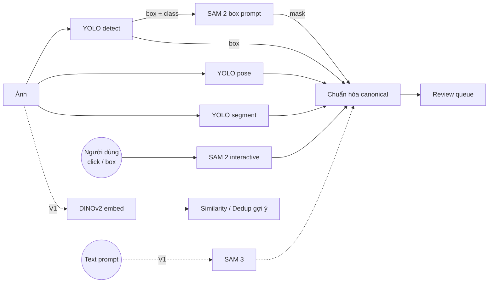
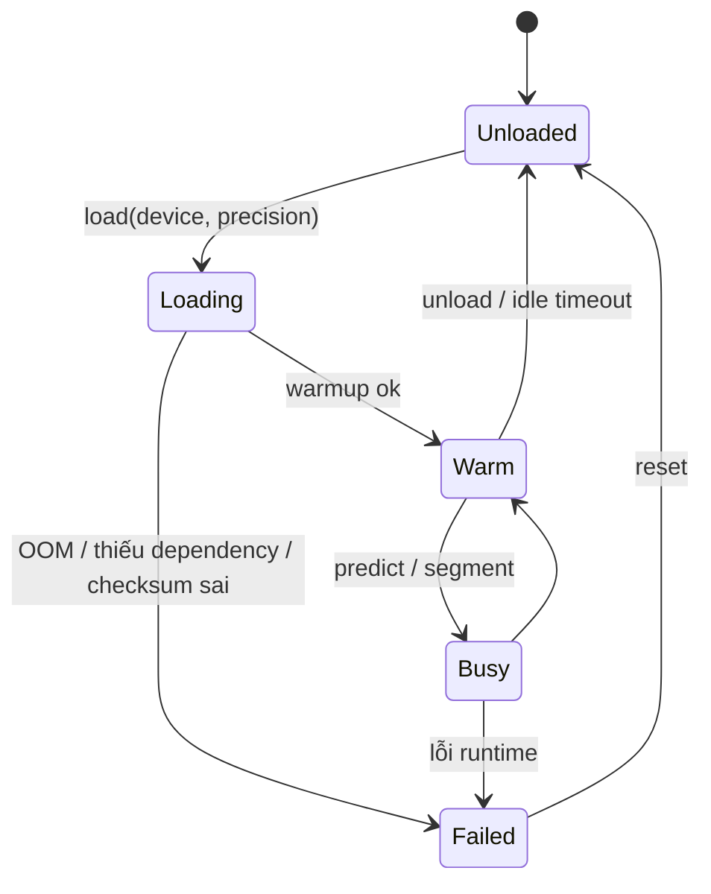

# 05 — Model & Inference Design

> Model registry, ma trận tương thích task–model, adapter, các pipeline kết hợp, vòng đời model và chiến lược fallback.
> Trạng thái: **PROPOSAL** · Cập nhật: 2026-11-24 · Thông tin model đã được xác minh ngày 2026-11-24, nguồn ở [03](../01-tong-quan/03_research_and_references.md)

## 1. Nguyên tắc

1. **Model không thay thế được cho nhau.** YOLO detect, segment và pose là các checkpoint/head khác nhau. SAM là model *promptable segmentation*. DINO là *feature backbone*.
2. **Adapter theo task**, dùng chung một registry. Không ép mọi model vào một hàm `predict()` chung chung.
3. Output của mọi adapter được **chuẩn hóa về canonical schema** ([06](../03-du-lieu/06_annotation_data_model.md)) ngay trong worker, trước khi rời khỏi worker.
4. **Không tự tải weights.** Chỉ tải khi người dùng bấm tải, có hiển thị nguồn, dung lượng, license và kiểm tra checksum.
5. **License là thuộc tính hạng nhất** của mỗi model và có thể *chặn* việc dùng model (xem [16](../07-van-hanh/16_security_privacy_and_licenses.md)).

## 2. Model ứng viên (đã xác minh 2026-11-24)

| Họ model | Phiên bản / checkpoint | Vai trò | License | Ghi chú quan trọng |
|---|---|---|---|---|
| Ultralytics YOLO | **YOLO26** (n/s/m/l/x, phát hành 01/2026), YOLO11 (ổn định); package `ultralytics` 8.4.x | Detect, segment, pose (và classify, OBB, semantic, depth với YOLO26) | **AGPL-3.0**; sản phẩm closed-source cần **Enterprise License** | Ultralytics coi cả weights là AGPL. Phát hành rất thường xuyên, phải **pin version** |
| SAM 2 / 2.1 | hiera tiny (38.9M) / small (46M) / base+ (80.8M) / large (224.4M) | Promptable segmentation (point / box / mask), ảnh và video | **Apache 2.0** (code + checkpoint) | Repo Meta khuyến nghị WSL, chưa hỗ trợ Windows native. Có trong `transformers` (`Sam2Model`) |
| SAM 3 / 3.1 | ~848M tham số; SAM 3.1 "Object Multiplex" (03/2026) | Concept segmentation: text prompt hoặc exemplar → detect + segment mọi instance; vẫn nhận point/box/mask | **SAM License** (tùy chỉnh) | **Gated** trên Hugging Face. Cần Python ≥ 3.12, PyTorch ≥ 2.7, GPU CUDA ≥ 12.6. Có trong `transformers` (`Sam3Model`) |
| DINOv2 | ViT-S/B/L/g /14 (có bản with registers) | Embedding: similarity, near-duplicate, clustering | **Apache 2.0** (trừ Cell-DINO, XRay-DINO là non-commercial) | Không có detection head |
| DINOv3 | ViT-S/S+/B/L/H+ /16 (distilled), 7B, ConvNeXt T/S/B/L | Embedding chất lượng cao hơn | **DINOv3 License** (tùy chỉnh, Meta có thể đổi điều khoản) | Gated. Các head detect/segment chính thức chạy trên backbone **7B**, không thực tế cho desktop |

## 3. Ma trận tương thích task–model

| Task | Model/pipeline | Hỗ trợ | Tier | Ghi chú |
|---|---|:-:|:-:|---|
| BBox | YOLO detect | ✅ | MVP | Class theo checkpoint (COCO-80 với pretrained) → map sang class project |
| BBox | SAM 3 text prompt | ✅ (bbox suy ra từ mask) | V1 | Class lấy từ text prompt |
| BBox | SAM 2 | ❌ | — | Không sinh box nếu không có prompt; không có class |
| BBox | DINOv2/v3 | ❌ | — | Không có detection head khả thi trên desktop |
| SEG instance | YOLO segment | ✅ | MVP | Mask → polygon |
| SEG instance | YOLO detect → SAM 2 (box prompt) | ✅ | MVP | Class lấy từ YOLO; thường cho mask mịn hơn (cần đo, chưa có số liệu) |
| SEG instance | SAM 2 interactive (click / box) | ✅ | MVP | Class do người dùng chọn |
| SEG instance | SAM 3 text/exemplar prompt | ✅ | V1 | Phụ thuộc license và quyền truy cập |
| SEG semantic | YOLO26 semantic | ⚠️ | Future | Ngoài phạm vi MVP (A-05) |
| POSE | YOLO pose | ✅ | MVP | Schema COCO-17 với checkpoint pretrained (UNVERIFIED với YOLO26, phải kiểm tra `kpt_shape` khi load) |
| POSE | SAM / DINO | ❌ | — | Không có head pose |
| Embedding | DINOv2 | ✅ | V1 | Similarity, near-duplicate, gợi ý cụm |
| Embedding | DINOv3 | ✅ | Future | Gated + license tùy chỉnh |

Registry dùng chính ma trận này để **chặn** tổ hợp không hợp lệ (BR-05, AC-02).

## 4. Model registry

### 4.1 Model descriptor

```yaml
# registry/models/yolo26n-seg.yaml (ví dụ — giá trị sẽ được xác minh khi implement)
model_id: ultralytics.yolo26n-seg
family: ultralytics-yolo
display_name: "YOLO26n Segment"
version: "26"
tasks: [instance_segment]
adapter: yolo.segment
runtime:
  python_package: "ultralytics==<pinned>"
  min_torch: "1.8"
devices: [cuda, cpu]
checkpoint:
  file: yolo26n-seg.pt
  source_url: <official release URL>
  sha256: <pinned>
  size_mb: <measured>
license:
  id: AGPL-3.0
  blocks_closed_source: true
  notice_url: https://www.ultralytics.com/license
classes: coco80            # đọc từ checkpoint khi load, so sánh với descriptor
input:
  default_imgsz: 640
capability_profile:        # ESTIMATE ban đầu, được thay bằng số đo benchmark
  vram_mb_by_batch: {1: null, 8: null}
  supports_fp16: true
  supports_batch: true
  cancellable: chunk
```

- Registry có hai nguồn: **built-in manifest** (danh sách model đã kiểm tra, có checksum được pin) và **custom checkpoint** do người dùng thêm (ví dụ YOLO đã fine-tune). Với custom checkpoint, app tính sha256, đọc tên class và task từ checkpoint, rồi đánh dấu `source=user`.
- **Model family** được tách khỏi **checkpoint**: một family có thể có nhiều checkpoint với task khác nhau.

### 4.2 Trạng thái model

`not_downloaded → downloading → verifying → ready`, cùng các trạng thái lỗi `checksum_failed`, `incompatible_runtime`, `license_blocked`, `access_required` (dùng cho model gated).

## 5. Adapter

### 5.1 Hợp đồng chung (chạy trong worker process)

```python
class ModelAdapter(Protocol):
    descriptor: ModelDescriptor

    def check_environment(self) -> EnvReport: ...          # dependency, phiên bản torch/CUDA
    def load(self, device: Device, precision: Precision) -> LoadReport: ...
    def warmup(self) -> None: ...
    def unload(self) -> None: ...                          # giải phóng VRAM, empty_cache
    def report(self) -> RuntimeInfo: ...                   # device, phiên bản model/package

class BatchPredictor(ModelAdapter, Protocol):              # YOLO detect / segment / pose, SAM 3 text
    def validate_params(self, params: dict) -> Params: ...
    def predict_batch(self, items: list[ImageRef], params: Params,
                      cancel: CancelToken) -> list[CanonicalPrediction]: ...

class PromptableSegmenter(ModelAdapter, Protocol):         # SAM 2 / SAM 3 interactive
    def set_image(self, image: ImageRef) -> EmbeddingHandle: ...
    def segment(self, handle: EmbeddingHandle, prompts: Prompts) -> list[MaskResult]: ...

class EmbeddingExtractor(ModelAdapter, Protocol):          # DINOv2 / v3
    def embed_batch(self, items: list[ImageRef]) -> EmbeddingBatch: ...
```

Đây là *interface theo task* dùng chung registry, không phải một interface chung cho mọi model.

### 5.2 Danh sách adapter

| Adapter | Hiện thực bằng (PROPOSAL) | Lý do | Phương án thay thế |
|---|---|---|---|
| `yolo.detect` / `yolo.segment` / `yolo.pose` | Package `ultralytics` (pin version) | Đường duy nhất thực tế để dùng weights YOLO26/YOLO11 | Export ONNX rồi chạy bằng ONNX Runtime (vẫn là weights AGPL) |
| `sam2.prompt` | `transformers` `Sam2Model` / `Sam2Processor` | Apache 2.0, thuần PyTorch, tránh vấn đề build CUDA extension và Windows của repo Meta, tránh AGPL của wrapper Ultralytics | Repo `facebookresearch/sam2` (khuyến nghị WSL); wrapper Ultralytics (AGPL) |
| `sam2.from_boxes` | Như trên, nhận box từ YOLO | Pipeline B | — |
| `sam3.concept` (V1) | `transformers` `Sam3Model` | Cùng hệ sinh thái với SAM 2 | Repo Meta; Ultralytics `SAM3SemanticPredictor` |
| `dinov2.embed` (V1) | `transformers` `Dinov2Model` | Apache 2.0 | `torch.hub` |
| `dinov3.embed` (Future) | `transformers` (≥ 4.56) | Gated, license tùy chỉnh | — |

> Nếu dự án phải là closed-source và không mua Enterprise License của Ultralytics, ba adapter `yolo.*` phải được thay bằng detector/segmenter/pose có license phù hợp. Ứng viên **cần nghiên cứu và xác minh** (UNVERIFIED): RT-DETR / D-FINE (detect), RTMDet / RTMPose của OpenMMLab (detect/pose). Kiến trúc adapter cho phép thay thế mà không sửa core.

### 5.3 Chuẩn hóa output

| Adapter | Output gốc | Canonical |
|---|---|---|
| YOLO detect | `boxes.xyxy`, `conf`, `cls` | `bbox` XYXY pixel (theo oriented image), `confidence`, class model → map sang class project |
| YOLO segment | box + mask/polygon (`masks.xy`) | `instance_mask` dạng polygons (+ RLE nếu cần); bbox lấy từ box của model |
| YOLO pose | box + `keypoints.xy`, `keypoints.conf` | `pose`: `points[k] = {x, y, conf, v}` với `v` suy ra từ `kpt_conf_threshold` |
| SAM 2/3 | Mask nhị phân, score | RLE canonical → polygon; bbox từ mask; class theo [06 §5](../03-du-lieu/06_annotation_data_model.md) |
| DINO | Vector embedding | Không phải annotation. Lưu vào embedding store (V1, Bước 03 quyết định cách lưu) |

Bắt buộc trong mọi adapter:
- Áp EXIF orientation **giống nhau** ở bước tiền xử lý và hậu xử lý.
- Clip tọa độ vào biên ảnh, đồng thời **ghi nhận** việc đã clip vào `attributes.clipped=true`.
- Loại bỏ box/polygon suy biến và đếm số lượng đã loại vào báo cáo chunk.

## 6. Pipeline kết hợp

| Mã | Pipeline | Tier | Chạy remote được? | Ghi chú |
|---|---|:-:|:-:|---|
| A | YOLO detect → BBox | MVP | ✅ | Pipeline đơn giản nhất, dùng cho MVP-α |
| B | YOLO detect → SAM 2 (box prompt) → mask/polygon | MVP | ✅ | Chạy hai adapter trong cùng một worker; class lấy từ YOLO; có tham số `refine_classes` |
| C | YOLO pose → keypoints | MVP | ✅ | |
| D | SAM 2 interactive (point +/−, box) → người dùng chỉnh | MVP | ❌ (chỉ local) | Độ trễ của Kaggle quá lớn cho thao tác interactive |
| E | DINOv2 embeddings → similarity / near-duplicate / gợi ý cụm | V1 | ✅ | Kết quả chỉ là *gợi ý*, không phải annotation |
| F | SAM 3 text prompt ("helmet") → mask + bbox | V1 | ✅ | Là ứng viên tốt cho Kaggle khi máy local không đáp ứng yêu cầu CUDA ≥ 12.6 |



## 7. Vòng đời model trong worker



- Mỗi worker giữ tối đa **N model** cùng lúc (mặc định 1 cho batch; phiên interactive giữ SAM 2 riêng). Giới hạn VRAM là điều kiện khi load nhiều model.
- **Idle timeout** (mặc định 5 phút, có cấu hình) để giải phóng VRAM khi người dùng không dùng nữa.
- Pipeline B load YOLO rồi SAM 2 trong cùng worker. Nếu VRAM không đủ cho cả hai thì chạy tuần tự theo chunk: YOLO cho toàn bộ chunk → unload → SAM 2.

## 8. Cache và tải model

- Thư mục model cache của app: `%LOCALAPPDATA%\AutoLabelStudio\models\` (Windows), `~/.local/share/autolabel-studio/models/` (Linux). Có thể đổi trong Settings.
- Biến môi trường `HF_HOME` / `HF_HUB_CACHE` và `YOLO_CONFIG_DIR` của worker được trỏ vào cache của app, để thư viện không âm thầm ghi ra nơi khác.
- Model gated (SAM 3, DINOv3) cần Hugging Face token do người dùng tự cấu hình qua `hf auth login` hoặc keyring. App **không** xin token trong chat và **không** ghi token ra log.
- Tắt cơ chế tự tải ngầm của thư viện: worker chỉ load từ đường dẫn checkpoint đã được xác minh (ví dụ truyền path đầy đủ cho `YOLO(...)` thay vì tên model).

## 9. Tham số inference

| Tham số | Áp dụng | Mặc định (PROPOSAL) |
|---|---|---|
| `conf` | YOLO, SAM 3 | 0.25 |
| `iou` (NMS) | YOLO | 0.7 |
| `imgsz` | YOLO | 640 |
| `classes` (lọc class) | YOLO | tất cả |
| `max_det` | YOLO | 300 |
| `batch` | Tất cả adapter batch | do router quyết định |
| `precision` | GPU | fp16 nếu được hỗ trợ, ngược lại fp32 |
| `kpt_conf_threshold` | YOLO pose | 0.5 |
| `mask_min_area`, `polygon_tolerance` | Mọi adapter SEG | 16 px², 1.0 px |
| `multimask_output` | SAM interactive | true (người dùng chọn mask) |

Preset được lưu theo project. Mọi tham số được ghi vào `params` của job để có thể tái lập (FR-AI-09).

## 10. Fallback và xử lý lỗi model

| Tình huống | Hành vi |
|---|---|
| Model không hỗ trợ task | Chặn trước khi tạo job (BR-05) |
| Thiếu dependency hoặc runtime không khớp | `incompatible_runtime`; gợi ý cài extra tương ứng ([11](../05-phat-trien/11_environment_and_setup.md)) |
| CUDA OOM | Theo chính sách OOM ở [08 §6](08_hardware_and_compute_routing.md) |
| Model gated chưa có quyền | `access_required`, kèm hướng dẫn xin quyền truy cập |
| Lỗi ở một ảnh | Ghi lỗi theo ảnh, chạy tiếp các ảnh còn lại |
| Worker crash | Job → INTERRUPTED; chunk đang chạy chuyển về `pending` |
| Class của checkpoint không có trong project | Bắt buộc mở dialog mapping trước khi chạy (FR-CLS-04) |
