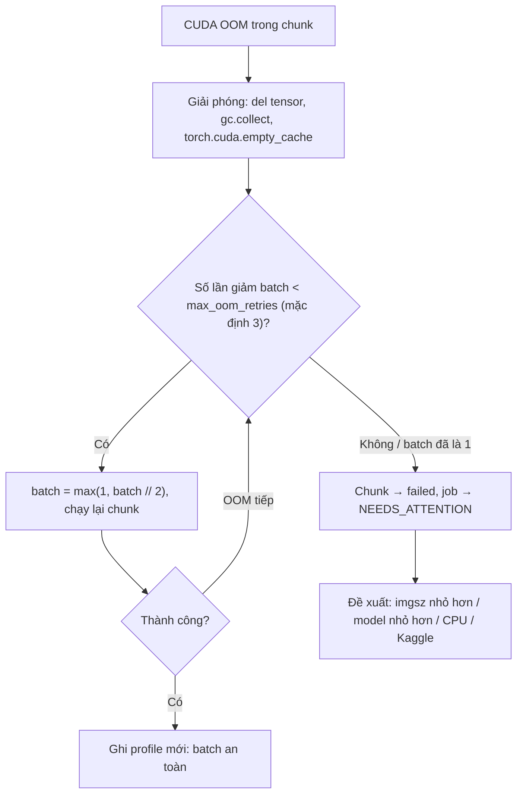

# 08 — Hardware Detection & Compute Routing

> Thiết kế Hardware & Compute Manager: probe phần cứng, capability profile, chính sách chọn thiết bị, xử lý OOM và điều kiện chuyển sang remote.
> Trạng thái: **PROPOSAL** · Cập nhật: 2026-11-24

## 1. Mục tiêu

- Biết **chắc** máy có thể chạy model–task nào trước khi chạy, không đoán theo tên GPU.
- Luôn **giải thích** lý do chọn LOCAL_GPU / LOCAL_CPU / REMOTE_KAGGLE / MANUAL_REQUIRED.
- Không bao giờ tự upload dữ liệu. Chế độ remote luôn cần consent cho từng job (BR-04).

## 2. Hardware probe

Probe chạy **trong worker process**, vì đó là môi trường Python có PyTorch. UI process chỉ đọc thông tin hệ điều hành cơ bản. Kết quả được cache và làm mới khi người dùng bấm "Kiểm tra lại", hoặc khi driver/môi trường thay đổi.

| Hạng mục | Cách lấy (PROPOSAL) | Ghi chú |
|---|---|---|
| OS, phiên bản, kiến trúc | `platform` | |
| CPU: model, số core vật lý/logic | `platform`, `psutil`, `os.cpu_count()` | |
| RAM tổng/trống | `psutil.virtual_memory()` | |
| Ổ đĩa trống (workspace, cache, temp) | `shutil.disk_usage` | Cảnh báo khi dưới ngưỡng |
| GPU NVIDIA: tên, VRAM tổng/trống, driver | `nvidia-ml-py` (NVML) | Không có NVML thì coi như không có GPU NVIDIA |
| CUDA runtime mà PyTorch dùng | `torch.version.cuda`, `torch.cuda.is_available()` | So sánh với driver |
| VRAM trống theo PyTorch | `torch.cuda.mem_get_info()` | Đo ngay trước khi load model |
| Compute capability | `torch.cuda.get_device_capability()` | Quyết định fp16/bf16 |
| Accelerator khác | Apple MPS (roadmap macOS); DirectML/ROCm **không** có trong MVP | Không hứa hẹn hỗ trợ |
| Dependency model | Import thử + đọc phiên bản (`ultralytics`, `transformers`) | |
| **Smoke test** | Tạo tensor nhỏ trên device, chạy một phép matmul, đồng bộ, giải phóng | Phát hiện driver hỏng dù `is_available()` vẫn trả về True |

**Hardware report** được lưu dạng JSON (không có thông tin nhạy cảm), hiển thị ở màn hình Settings → Hardware và có thể đưa vào gói chẩn đoán.

## 3. Capability profile

Không dùng một ngưỡng VRAM chung cho mọi model. Profile gắn với **(model, checkpoint, task, imgsz, precision, batch)**.

| Trường | Ý nghĩa |
|---|---|
| `vram_peak_mb` | VRAM đỉnh đo được |
| `ram_peak_mb` | RAM đỉnh |
| `throughput_img_s` | Số ảnh/giây đo được |
| `source` | `estimate` (bảo thủ, chưa đo) hoặc `measured` (benchmark trên chính máy này) |
| `measured_at`, `device_name`, `driver`, `torch_version` | Để biết profile có còn hợp lệ không |

Quy trình:
1. Lần đầu dùng: lấy **ước lượng bảo thủ** từ descriptor (`source=estimate`) và hiển thị nhãn "ước lượng".
2. Có nút **"Benchmark model này"**: chạy N ảnh mẫu với batch tăng dần cho đến khi gặp giới hạn, ghi `vram_peak_mb` và `throughput` → `source=measured`.
3. Mỗi lần chạy job thật, cập nhật profile theo số đo thực tế (peak VRAM theo `torch.cuda.max_memory_allocated`).

Tài liệu **không đưa ra số VRAM cụ thể** cho từng model khi chưa đo trên máy thật.

## 4. Execution modes

| Mode | Điều kiện | Ghi chú |
|---|---|---|
| `LOCAL_GPU` | GPU NVIDIA, PyTorch CUDA chạy được, smoke test qua, VRAM trống ≥ profile × hệ số an toàn (mặc định 1.2) | Ưu tiên cao nhất ở chế độ Auto |
| `LOCAL_CPU` | Task phù hợp CPU và khối lượng ước tính dưới ngưỡng thời gian người dùng đặt (mặc định cảnh báo khi > 30 phút) | Luôn hiển thị cảnh báo tốc độ |
| `REMOTE_KAGGLE` | Job là **batch**, Kaggle đã được cấu hình và kiểm tra, người dùng xác nhận upload | Không bao giờ dùng cho job interactive |
| `MANUAL_REQUIRED` | Không có đường chạy nào khả thi, hoặc cần người dùng quyết định | Kèm hướng dẫn cụ thể |

## 5. Router

**Input:** model/checkpoint, task, số ảnh, imgsz, batch đề xuất, precision, RAM/VRAM hiện có, user policy (`auto`, `force_cpu`, `force_gpu`, `force_kaggle`, giới hạn VRAM/RAM), job type (`batch` hoặc `interactive`), trạng thái remote profile.

**Output:**
```json
{
  "mode": "LOCAL_GPU",
  "device": "cuda:0",
  "batch": 8, "imgsz": 640, "precision": "fp16",
  "reasons": ["GPU RTX ... có 7.1 GB trống", "Profile đo được: cần 3.2 GB với batch 8"],
  "warnings": [],
  "estimates": {"duration_s": null, "source": "estimate"},
  "required_user_action": null
}
```

**Quy tắc (theo thứ tự, deterministic):**
1. Model không hỗ trợ task → chặn (không phải là quyết định của router).
2. User policy `force_*` → kiểm tra tính khả thi của mode đó. Không khả thi thì trả `MANUAL_REQUIRED` kèm lý do; không tự đổi sang mode khác.
3. `auto`:
   1. GPU dùng được và VRAM đủ với batch đề xuất → `LOCAL_GPU`.
   2. GPU dùng được nhưng VRAM thiếu → giảm batch (tối thiểu 1) và/hoặc chuyển fp16. Vẫn thiếu → bước 3.3.
   3. Model chạy được trên CPU (descriptor `devices` có `cpu`) và thời gian ước tính chấp nhận được, hoặc người dùng chấp nhận cảnh báo → `LOCAL_CPU`.
   4. Job batch, remote đã cấu hình → đề xuất `REMOTE_KAGGLE` (cần consent).
   5. Còn lại → `MANUAL_REQUIRED`.
4. Job interactive chỉ có thể nhận `LOCAL_GPU` hoặc `LOCAL_CPU`.
5. Ngưỡng giới hạn do người dùng đặt (VRAM/RAM tối đa) luôn được áp dụng trước.

Router là **hàm thuần** (pure function, dễ unit test), nhận snapshot phần cứng làm tham số. Mọi quyết định được ghi vào job (`routing_decision`) để audit.

## 6. Chính sách OOM



- Chỉ bắt `torch.OutOfMemoryError` (hoặc `torch.cuda.OutOfMemoryError` tùy phiên bản), **không** bắt mọi `RuntimeError`.
- Không retry vô hạn. Không tự chuyển sang Kaggle, vì đó là quyết định của người dùng.
- Phiên interactive gặp OOM: unload model khác đang giữ, thử lại một lần, sau đó đề xuất model SAM nhỏ hơn (tiny/small).

## 7. Theo dõi tài nguyên khi chạy job

- Worker gửi sự kiện `resource {vram_used, vram_total, gpu_util, ram_used}` theo chu kỳ (mặc định 2 s) qua NVML và psutil.
- UI hiển thị trong Job panel. Cảnh báo khi VRAM > 95% hoặc ổ đĩa của thư mục job sắp đầy.
- Concurrency: mặc định **một batch job GPU** tại một thời điểm, cộng thêm một phiên interactive. Các job khác nằm trong hàng đợi.

## 8. Điều kiện kích hoạt remote

| Điều kiện | Bắt buộc |
|---|---|
| Job type là batch | ✅ |
| Kaggle provider đã cấu hình: CLI có sẵn, xác thực ok, đã kiểm tra quyền dùng GPU | ✅ |
| Model và license cho phép chạy trên hạ tầng bên thứ ba (một số model gated cần token trên kernel) | ✅ |
| Người dùng xem và xác nhận danh sách và dung lượng dữ liệu sẽ upload | ✅ (mỗi job) |
| Dung lượng gói nằm trong giới hạn của Kaggle | ✅ — xem [09](09_kaggle_remote_worker.md) |

## 9. Giao diện người dùng liên quan

- **Settings → Compute:** policy mặc định, giới hạn VRAM/RAM, ngưỡng cảnh báo thời gian CPU, max OOM retries.
- **Dialog trước khi chạy job:** mode được chọn, lý do, cảnh báo, ước lượng (có nhãn estimate/measured); cho phép đổi mode nếu khả thi.
- **Settings → Hardware:** báo cáo probe, nút "Kiểm tra lại", "Benchmark", "Copy báo cáo".

## 10. Kiểm thử

- Unit test router với snapshot phần cứng giả lập: không GPU, GPU nhỏ, GPU lớn, driver lỗi, remote chưa cấu hình hoặc đã cấu hình, mọi giá trị của policy.
- Test chính sách OOM bằng adapter giả ném OOM theo kịch bản.
- Test trên máy thật (khi có GPU): smoke test, benchmark, đo peak VRAM. Kết quả ghi vào báo cáo test, không bịa số.
