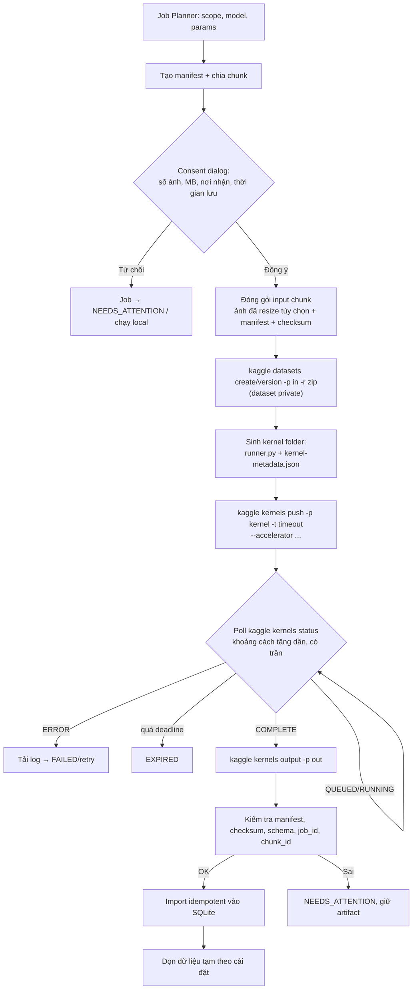

# 09 — Kaggle Remote Worker

> Thiết kế remote inference trên Kaggle GPU, điều khiển hoàn toàn bằng **Kaggle CLI**. Kaggle là compute worker, không phải giao diện của sản phẩm.
> Trạng thái: **PROPOSAL** · Cập nhật: 2026-11-24 · CLI đã xác minh với `kaggle` 2.2.5 trên github.com/Kaggle/kaggle-api. Các giới hạn nền tảng đa số **UNVERIFIED** (xem §8)

## 1. Phạm vi và nguyên tắc

- Chỉ dùng cho **batch job** (pipeline A, B, C, E, F ở [05](05_model_and_inference_design.md)). Interactive SAM không chạy remote.
- Desktop app vẫn là nơi quản lý project, annotation, review và export. Kaggle chỉ nhận một gói input tối thiểu và trả về prediction.
- Kaggle provider được cài đặt sau interface `RemoteComputeProvider`, để sau này có thể thêm SSH worker hoặc provider khác mà không sửa core.
- Mỗi lần upload cần **consent cho đúng job đó** (BR-04). Không có chế độ "luôn đồng ý" trong MVP.
- Không bao giờ giả định GPU luôn có, luôn miễn phí, hay có quota cố định.

## 2. Thiết lập một lần (do người dùng thực hiện)

| Bước | Hành động | Ghi chú |
|---|---|---|
| 1 | Có tài khoản Kaggle; **xác minh số điện thoại** để dùng GPU/Internet | UNVERIFIED (nguồn forum), phải kiểm tra lại khi implement |
| 2 | Tạo API token trên trang Settings của tài khoản Kaggle | Đây là thao tác web duy nhất, chỉ làm khi thiết lập; quy trình chạy job hằng ngày không cần trình duyệt |
| 3 | Cấu hình token theo một trong các cách CLI hỗ trợ: biến môi trường `KAGGLE_API_TOKEN`; file `~/.kaggle/access_token`; hoặc file legacy `kaggle.json` (`C:\Users\<user>\.kaggle\kaggle.json` trên Windows) / `KAGGLE_USERNAME` + `KAGGLE_KEY` | Không dùng `kaggle auth login` trong luồng tự động, vì lệnh này mở trình duyệt |
| 4 | Trong app: Settings → Remote → **Kiểm tra kết nối** | App chạy một lệnh đọc (ví dụ `kaggle kernels list --mine`, cần xác minh) và chỉ báo OK/FAIL, **không hiển thị token** |

- App **không yêu cầu người dùng dán token vào app** trong MVP. Token do Kaggle CLI quản lý theo vị trí chuẩn. Nếu sau này app quản lý token (V1), token sẽ được lưu trong OS keyring và chỉ truyền cho subprocess qua biến môi trường.
- CLI được cài trong môi trường riêng của app, pin phiên bản **`kaggle>=2.2.5`**, vì bản 2.2.5 sửa lỗi certifi có thể lộ token khi bị MITM. CLI yêu cầu Python ≥ 3.11.

## 3. Luồng thực thi



### 3.1 Gói input (`input/`)

```
input/
├── manifest.json        # job_id, chunk_id, correlation_id, schema_version, model_ref, params, danh sách ảnh + sha256
├── images/<image_id>.<ext>
└── worker/              # wheel của autolabel_worker (cùng version với app) + requirements đã pin
```

- Tên file trong gói là **`image_id`**, không phải đường dẫn gốc. Như vậy không lộ cấu trúc thư mục hay tên file nhạy cảm của người dùng (data minimization).
- Có tùy chọn **resize trước khi upload** (giữ hệ số scale trong manifest để quy đổi tọa độ khi import). Mặc định tắt, vì resize có thể làm giảm chất lượng mask.
- Kích thước chunk được chọn sao cho thời gian chạy ước tính nằm dưới timeout và gói nhỏ hơn giới hạn dataset (§8).
- `datasets create` mặc định là **private**, nhưng dir-mode mặc định là `skip` (bỏ qua thư mục con). Vì vậy bắt buộc dùng `-r zip` (hoặc `tar`).

### 3.2 Kernel (`kernel/`)

`kernel-metadata.json` (các trường đã xác minh trong tài liệu `kernels_metadata.md`):

```json
{
  "id": "<username>/autolabel-job-<short_job_id>",
  "title": "autolabel-job-<short_job_id>",
  "code_file": "runner.py",
  "language": "python",
  "kernel_type": "script",
  "is_private": true,
  "enable_gpu": true,
  "enable_internet": true,
  "machine_shape": "NvidiaTeslaT4",
  "dataset_sources": ["<username>/autolabel-in-<short_job_id>"],
  "model_sources": []
}
```

`runner.py`:
1. Ghi lại môi trường (`nvidia-smi`, phiên bản torch, Python) vào `/kaggle/working/env.json`.
2. Cài wheel `autolabel_worker` cùng các dependency đã pin từ dataset input. Nếu thiếu, cài từ PyPI (cần `enable_internet`).
3. Tải checkpoint từ nguồn chính thức theo URL đã pin và **kiểm tra sha256**. Model gated thì xem §6.
4. Chạy `python -m autolabel_worker run --manifest ... --out /kaggle/working/out`, đúng code worker được dùng ở local (ADR-006).
5. Ghi `predictions.jsonl`, `chunk_report.json`, `worker.log` và `output_manifest.json` (có checksum) vào `/kaggle/working/out`.
6. Có `try/finally` để luôn ghi `output_manifest.json` với `status`, kể cả khi lỗi.

### 3.3 Theo dõi

- `kaggle kernels status <user>/<slug>` trả về các trạng thái `QUEUED`, `RUNNING`, `COMPLETE`, `ERROR`, `CANCEL_REQUESTED`, `CANCEL_ACKNOWLEDGED`, `NEW_SCRIPT` (enum `KernelWorkerStatus` trong `kagglesdk`). Định dạng chữ in ra của CLI chưa được xác minh, nên **parse lỏng**, hoặc gọi `kagglesdk` trực tiếp (PROPOSAL, đánh giá ở Bước 05).
- Poll với khoảng cách tăng dần: 15 s → 30 s → 60 s, trần 120 s. Có **deadline tổng** = `timeout` của kernel + biên 15 phút.
- Log: `kaggle kernels logs` có trong CHANGELOG 2.2.5 nhưng chưa có trong tài liệu chính, nên dùng nếu có. Đường dự phòng là `worker.log` trong output.
- Bảng ánh xạ trạng thái: `QUEUED` → `SUBMITTED`; `RUNNING` → `RUNNING`; `COMPLETE` → `COLLECTING`; `ERROR` → `FAILED` (tải log); `CANCEL_*` → `CANCELLED`; quá deadline → `EXPIRED`.

### 3.4 Thu kết quả

- `kaggle kernels output <user>/<slug> -p <job_dir>/out` (có `--file-pattern` để chỉ tải những gì cần).
- Kiểm tra theo thứ tự: `output_manifest.json` tồn tại → `job_id`/`chunk_id` khớp → checksum của từng file → JSON Schema của `predictions.jsonl` → mọi `image_id` thuộc scope của job (BR-10).
- Import theo chunk, idempotent với khóa `(job_id, chunk_id)` ([04 §9](04_system_architecture.md)).

## 4. Hủy, timeout, retry, resume

| Vấn đề | Thiết kế |
|---|---|
| **Hủy** | CLI **không có lệnh dừng kernel đang chạy** (đã xác minh: không có trong docs và CHANGELOG). Khi người dùng bấm Cancel, app ngừng theo dõi, đánh dấu `CANCEL_REQUESTED → CANCELLED` ở phía local, bỏ qua kết quả về sau và thông báo rõ: *"Kernel trên Kaggle có thể vẫn chạy cho tới khi hết timeout và vẫn tính vào quota GPU"* |
| **Timeout** | Luôn đặt `kaggle kernels push -t <seconds>` theo ước tính của chunk × hệ số an toàn. Đây là giới hạn chi phí cứng duy nhất |
| **Session/quota hết** | `ERROR` hoặc `EXPIRED` → chunk vẫn `pending` → người dùng có thể Resume sau, hoặc chuyển chunk còn lại sang local |
| **Retry** | Tối đa 2 lần mỗi chunk với lỗi tạm thời (mạng, 5xx). Không retry khi lỗi xác thực hoặc lỗi schema |
| **Idempotency** | `slug` của kernel và dataset chứa `short_job_id` + `chunk_id`; trước khi push, kiểm tra kernel đã tồn tại và đã có output hợp lệ chưa để tránh chạy trùng |
| **App bị đóng khi job đang chạy** | Trạng thái đã lưu trong DB. Mở lại app → job `INTERRUPTED` → tiếp tục poll trạng thái của kernel thay vì push lại |

## 5. Dọn dẹp

| Dữ liệu | Mặc định | Lệnh |
|---|---|---|
| Kernel của job | Xóa sau khi import thành công | `kaggle kernels delete` (đã có trong tài liệu) |
| Dataset input | Xóa sau khi import thành công | Lệnh xóa dataset qua CLI **UNVERIFIED** → nếu không có thì ghi rõ cho người dùng và hướng dẫn xóa thủ công, đồng thời dùng `datasets version -d` để giảm số bản cũ |
| Thư mục job local | Giữ 7 ngày rồi xóa | Cấu hình được |

Người dùng được thông báo rằng dữ liệu đã upload nằm trên hạ tầng Kaggle cho tới khi bị xóa, và chịu điều khoản của Kaggle.

## 6. Model weights trên Kaggle

| Loại model | Cách đưa lên kernel |
|---|---|
| Có URL công khai (YOLO, SAM 2, DINOv2) | Kernel tải trực tiếp từ nguồn chính thức (cần `enable_internet`) và kiểm tra sha256 |
| Checkpoint custom của người dùng | Upload kèm gói input, hoặc lên Kaggle Model/Dataset riêng tư một lần rồi dùng lại qua `model_sources` / `dataset_sources` |
| Gated (SAM 3, DINOv3) | Cần token Hugging Face trên kernel. **Kaggle Secrets có cài được bằng CLI không thì chưa xác minh** → mặc định yêu cầu người dùng tự upload weights lên Kaggle Model riêng tư (phải kiểm tra license có cho phép không) |

## 7. Bảo mật

- Gọi CLI bằng `subprocess.run([...], shell=False, timeout=...)`, kèm validate slug/đường dẫn (chỉ cho phép `[a-z0-9-]`).
- Redact mọi chuỗi giống token trong stdout/stderr trước khi ghi log.
- Không đưa token vào `kernel-metadata.json`, manifest, gói input hay log.
- Output tải về là **dữ liệu không tin cậy**: chỉ parse JSON theo schema, không thực thi gì, giải nén có kiểm tra path traversal.
- Gói input dùng `image_id` làm tên file (§3.1).

## 8. Giới hạn nền tảng (phải kiểm tra lại khi implement)

| Hạng mục | Thông tin hiện có | Trạng thái |
|---|---|---|
| Quota GPU | Khoảng ~30 giờ/tuần, thay đổi theo thời điểm | UNVERIFIED |
| Thời gian một phiên | 12 giờ (CPU/GPU), 9 giờ (TPU) | UNVERIFIED |
| Dung lượng output `/kaggle/working` | 20 GB | UNVERIFIED |
| Dataset | ~200 GB/dataset, quota private 200 GB; giới hạn số file top-level | UNVERIFIED |
| Accelerator qua CLI | `NvidiaTeslaT4` (T4 ×2), `NvidiaL4`, `NvidiaL4X1`, `NvidiaTeslaA100`, `NvidiaH100`, … Một số chỉ dành cho competition hoặc admin. **P100 đã ngừng** | CONFIRMED (danh sách ID); loại GPU mà tài khoản free thực sự nhận được: UNVERIFIED |
| Rate limit API | Không công bố | UNVERIFIED |
| Xác minh số điện thoại cho GPU/Internet | Có (nguồn forum) | UNVERIFIED |
| **Điều khoản sử dụng** | AUP cấm lạm dụng tài nguyên (đào coin, "server farming"…). Có nguồn trích Terms giới hạn ở mục đích "internal, personal, non-commercial" | ⚠️ **Rủi ro pháp lý, cần chủ dự án/luật sư xem xét** trước khi phát hành thương mại |

App phải hiển thị cảnh báo: *Quota và khả dụng của GPU Kaggle có thể thay đổi; job có thể bị xếp hàng hoặc thất bại; dữ liệu tạm có thể bị xóa.*

## 9. Kiểm thử

- **Mock provider**: giả lập subprocess `kaggle` với các kịch bản: thành công, `ERROR`, xếp hàng lâu, hết deadline, output thiếu file, sai checksum, sai `job_id`, lỗi xác thực. Không cần tài khoản thật (bắt buộc trong CI).
- **Contract test** cho `runner.py`: chạy local trên CPU với manifest mẫu, phải ra đúng output schema.
- **Test thủ công có tài khoản thật** (khi chủ dự án cho phép): một job nhỏ (10 ảnh), ghi lại thời gian xếp hàng, thời gian chạy và quota đã dùng vào báo cáo.
