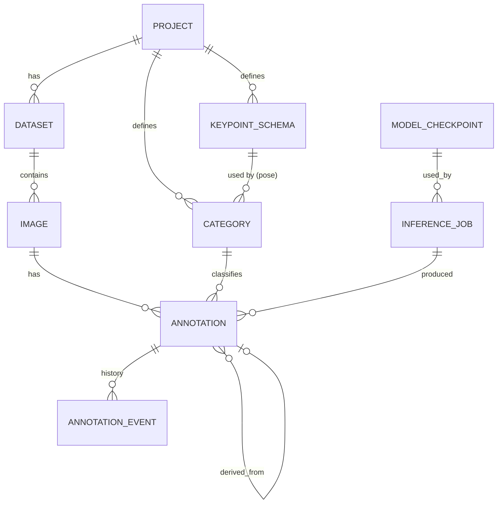
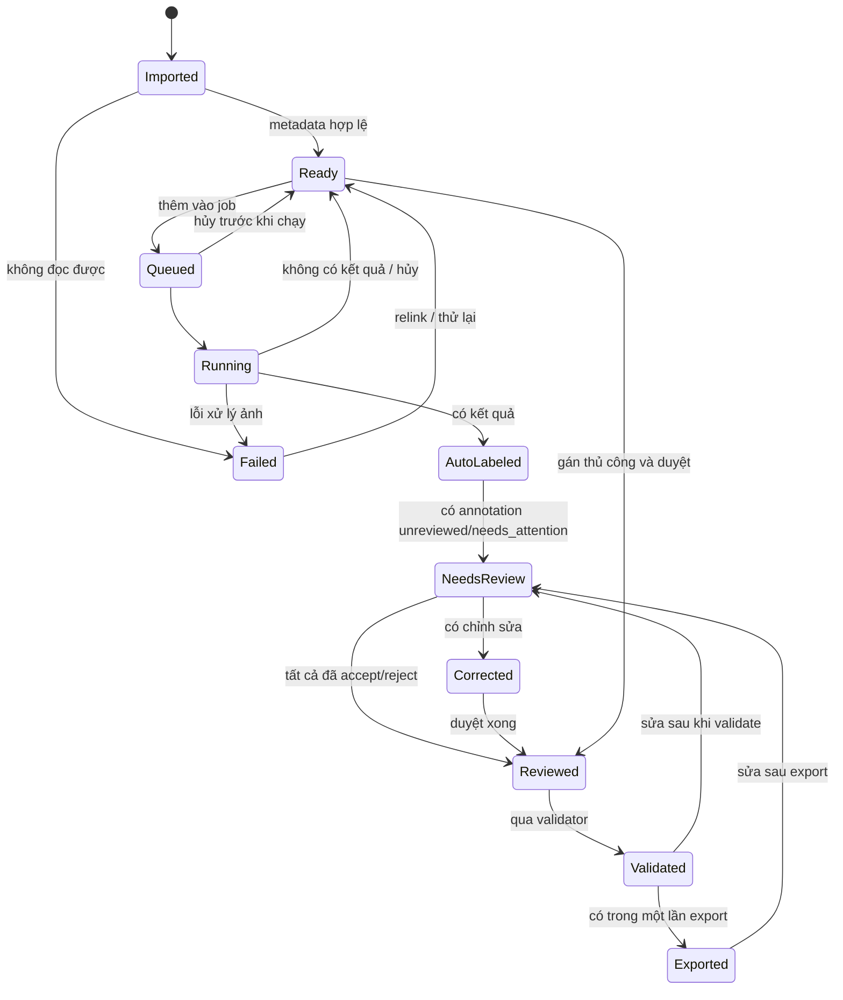

# 06 — Annotation Data Model

> Canonical annotation schema: trung lập với mọi format export, là "nguồn sự thật" duy nhất bên trong ứng dụng.
> Trạng thái: **PROPOSAL** (chờ duyệt; Bước 03 sẽ hiện thực hóa thành schema database) · Cập nhật: 2026-11-24

## 1. Nguyên tắc

1. **Một canonical schema**, nhiều adapter: YOLO, COCO, VOC và output của model đều phải được chuyển về schema này, không có ngoại lệ.
2. **Tọa độ pixel tuyệt đối**, không dùng tọa độ normalized bên trong ứng dụng. Việc normalize chỉ diễn ra lúc export.
3. **Lưu nguồn gốc (provenance) cho mọi annotation**, gồm ai/cái gì tạo ra, bằng model nào, trong job nào.
4. **Không mất thông tin âm thầm.** Thông tin không biểu diễn được ở format đích phải được báo trong export report.
5. **Phân biệt rõ** *auto-generated* và *human-verified* (BR-01, BR-02).

## 2. Hệ tọa độ (CONFIRMED trong phạm vi dự án, chờ duyệt)

| Quy ước | Giá trị |
|---|---|
| Không gian ảnh | Ảnh **sau khi áp dụng EXIF orientation** (gọi là *oriented image*) |
| Gốc tọa độ | Góc trên-trái của pixel trên-trái; trục x sang phải, y xuống dưới |
| Đơn vị | Pixel, số thực (`float64`); tâm pixel (i, j) nằm tại (i + 0.5, j + 0.5) |
| Miền hợp lệ | `0 ≤ x ≤ width`, `0 ≤ y ≤ height` (width/height của oriented image) |
| BBox | **XYXY**: `[x_min, y_min, x_max, y_max]`, ràng buộc `x_min < x_max`, `y_min < y_max` |
| Polygon | Danh sách đỉnh `[[x, y], ...]`, tối thiểu 3 đỉnh, **không lặp lại đỉnh đầu ở cuối** |
| Keypoint index | Bắt đầu từ 0 bên trong ứng dụng (COCO skeleton dùng 1-based → chuyển đổi khi import/export) |

**Chuyển đổi khi export:**

| Format | BBox | Ghi chú |
|---|---|---|
| YOLO | `cx cy w h` normalized theo width/height | Làm tròn 6 chữ số thập phân |
| COCO | `[x, y, w, h]` pixel | `area` tính từ mask/polygon nếu có, nếu không thì `w*h` |
| Pascal VOC | `xmin ymin xmax ymax`, quy ước 1-based (V1) | Cần kiểm tra lại quy ước làm tròn khi implement |

## 3. Thực thể logic



> Đây là mô hình logic. Bảng, cột, index và kiểu dữ liệu cụ thể do Bước 03 (`docs/03-du-lieu/database/`) quyết định.

### 3.1 Image (asset)

| Trường | Kiểu | Mô tả |
|---|---|---|
| `id` | UUIDv7 (text) | ID ổn định, không phụ thuộc đường dẫn |
| `dataset_id` | FK | |
| `relative_path` | text | Đường dẫn tương đối so với dataset root, dùng `/` làm phân cách |
| `file_size`, `mtime` | int | Dùng để phát hiện file thay đổi |
| `checksum` | text, nullable | `sha256` (bật hoặc tắt tùy cấu hình) |
| `width`, `height` | int | Kích thước của **oriented image** |
| `raw_width`, `raw_height` | int | Kích thước lưu trong file (trước khi áp EXIF) |
| `exif_orientation` | int 1–8, nullable | |
| `color_mode` | enum | `RGB`, `L` (grayscale), `RGBA`, `I;16`, … |
| `workflow_state` | enum | Xem mục 6 |
| `file_status` | enum | `ok`, `missing`, `changed`, `unreadable` |

### 3.2 Category

| Trường | Mô tả |
|---|---|
| `id` | ID nội bộ bất biến (BR-07) |
| `name`, `color`, `display_order` | |
| `task_scope` | Các task dùng được class này: `bbox`, `segment`, `pose` |
| `keypoint_schema_id` | Bắt buộc nếu class dùng cho pose |
| `is_archived` | Class đã ẩn nhưng vẫn giữ lại để đọc annotation cũ |

### 3.3 Keypoint schema

| Trường | Mô tả |
|---|---|
| `id`, `name`, `version` | Sửa một schema đang được dùng sẽ tạo version mới |
| `keypoints` | Danh sách có thứ tự `[{index, name}]` |
| `skeleton` | Danh sách cạnh `[[i, j]]`, 0-based |
| `flip_pairs` | Cặp điểm đối xứng trái/phải (để export `flip_idx` của YOLO) |

Preset: **COCO-17** (nose, left_eye, right_eye, left_ear, right_ear, left_shoulder, right_shoulder, left_elbow, right_elbow, left_wrist, right_wrist, left_hip, right_hip, left_knee, right_knee, left_ankle, right_ankle).

### 3.4 Annotation

| Trường | Kiểu | Mô tả |
|---|---|---|
| `id` | UUIDv7 | |
| `image_id` | FK | |
| `category_id` | FK, nullable | Có thể null khi mask do SAM sinh ra mà chưa gán class (xem §5) |
| `kind` | enum | `bbox`, `instance_mask`, `pose` |
| `bbox` | XYXY | Bắt buộc với mọi kind. Với `instance_mask`, bbox được suy ra từ geometry |
| `geometry` | typed payload | Xem §4 |
| `confidence` | float [0,1], nullable | Null với annotation do người tạo |
| `origin` | enum | `manual`, `auto`, `imported`, `corrected` |
| `review_status` | enum | `unreviewed`, `accepted`, `rejected`, `needs_attention` |
| `derived_from_id` | FK annotation, nullable | Trỏ tới bản dự đoán gốc khi bản này được sửa |
| `job_id` | FK, nullable | Job đã sinh ra annotation |
| `model_ref` | object, nullable | `{model_id, checkpoint_id, model_version, params_hash}` |
| `attributes` | JSON (đã validate) | `is_crowd`, `occluded`, `truncated`, `note`… |
| `revision` | int | Tăng mỗi lần sửa; dùng cho optimistic check |
| `created_at`, `updated_at` | UTC ISO-8601 | |
| `reviewed_at`, `reviewer` | nullable | `reviewer` là tên người dùng local trong MVP |

## 4. Geometry theo từng loại

### 4.1 `bbox`
Chỉ có trường `bbox`; `geometry = null`.

### 4.2 `instance_mask`
Có hai cách biểu diễn, ít nhất một trong hai phải có:

```json
{
  "type": "polygons",
  "polygons": [
    { "exterior": [[10.0, 12.5], [80.0, 12.5], [80.0, 90.0]], "holes": [] }
  ]
}
```

```json
{
  "type": "rle",
  "size": [height, width],
  "counts": "<COCO compressed RLE string>",
  "source_polygon_tolerance": null
}
```

| Quy tắc | |
|---|---|
| Nhiều polygon cho một instance | Hỗ trợ (vật thể bị che cắt thành nhiều mảnh) |
| Lỗ (holes) | Có trong schema từ MVP; công cụ vẽ lỗ trên UI để V1. Polygon COCO không có khái niệm lỗ → khi có lỗ, export COCO dùng **RLE** cho instance đó |
| Mask → polygon | Lấy contour rồi đơn giản hóa (Douglas–Peucker); lưu `tolerance` đã dùng; bỏ vùng nhỏ hơn `min_area` (có tham số và có báo cáo) |
| Polygon → mask | Rasterize theo kích thước oriented image |
| Mask lớn | Lưu RLE trong DB; nếu vượt ngưỡng kích thước (Bước 03 quyết định) thì lưu file `.rle`/`.png` trong project và DB giữ tham chiếu + checksum |
| Ảnh SAM trả về | Mask nhị phân → RLE canonical; polygon được sinh để người dùng chỉnh sửa |

### 4.3 `pose`

```json
{
  "type": "keypoints",
  "schema_id": "kps-coco17-v1",
  "points": [
    { "x": 120.3, "y": 45.1, "v": 2, "conf": 0.91 },
    { "x": 0.0,   "y": 0.0,  "v": 0, "conf": null }
  ]
}
```

| Quy tắc | |
|---|---|
| Số điểm | Phải bằng số keypoint của schema, đúng thứ tự |
| Visibility `v` | `0` = không gán nhãn (x, y = 0), `1` = có gán nhưng bị che, `2` = có gán và nhìn thấy (theo quy ước COCO) |
| Confidence từ model | Giữ ở `conf`; khi map sang `v` thì dùng ngưỡng `kpt_conf_threshold` (tham số job, có ghi provenance) |
| BBox | Bắt buộc (instance box); YOLO pose và COCO keypoints đều cần |
| Điểm ngoài ảnh | Validator báo lỗi nếu `v > 0` và điểm nằm ngoài miền hợp lệ |

## 5. Nguồn gốc và class của mask từ SAM

SAM 2 chỉ sinh **mask**, không sinh class. Class được xác định theo thứ tự ưu tiên sau:
1. Lấy class từ prompt nguồn (ví dụ box do YOLO detect sinh ra thì dùng class của box đó).
2. Lấy class mà người dùng đang chọn trên toolbar lúc click prompt.
3. Nếu không có cả hai: `category_id = null`, `review_status = needs_attention`, và export bị chặn cho đến khi được gán class.

SAM 3 (V1, có điều kiện): class lấy từ **text prompt mà người dùng nhập**, qua bảng mapping prompt → category; model không tự đặt tên class.

## 6. Workflow state của ảnh

Ảnh có `workflow_state` được **suy ra từ annotation và job**. Ứng dụng lưu sẵn để lọc nhanh và cập nhật trong cùng transaction với thao tác gây ra thay đổi.



| State | Định nghĩa |
|---|---|
| Imported | Đã có bản ghi, chưa đọc xong metadata |
| Ready | Đọc được, chưa có annotation auto nào đang chờ |
| Queued / Running | Nằm trong job đang chờ / đang chạy |
| Auto-labeled | Vừa nhận kết quả model (trạng thái chuyển tiếp) |
| Needs Review | Có ít nhất một annotation `unreviewed` hoặc `needs_attention` |
| Corrected | Có ít nhất một annotation đã sửa và chưa duyệt xong |
| Reviewed | Mọi annotation đã được duyệt (`accepted`/`rejected`/`manual`) |
| Validated | Qua validator, không có lỗi mức Error |
| Exported | Đã có trong ít nhất một lần export (lưu lịch sử export riêng) |
| Failed | Lỗi đọc file hoặc lỗi xử lý; kèm `error_code` |

## 7. Lịch sử và undo/redo

- **Undo/redo** dùng command stack trong bộ nhớ, theo từng ảnh (Command pattern), tối thiểu 100 bước. Mỗi command khi apply sẽ ghi xuống DB qua autosave.
- **Lịch sử bền vững:** bảng `annotation_events` (create / update / delete / review) lưu `before` và `after` dạng JSON, kèm actor và timestamp. Dùng cho audit và khôi phục, không dùng để undo.
- **Xóa** annotation auto chưa duyệt: dùng soft delete (`review_status = rejected`) để giữ thống kê chất lượng model. Xóa annotation do người tạo: xóa cứng, có ghi event.

## 8. Xử lý đặc biệt của ảnh

| Trường hợp | Cách xử lý |
|---|---|
| EXIF orientation | Áp dụng khi đọc metadata và khi hiển thị/đưa vào model; lưu `exif_orientation`. Khi export, width/height là kích thước oriented. Ghi chú trong export manifest |
| Grayscale | Hiển thị bình thường; khi đưa vào model thì chuyển sang 3 kênh RGB |
| Alpha (RGBA) | Bỏ alpha khi đưa vào model (ghép lên nền đen, có tham số); vẫn hiển thị alpha trên canvas |
| 16-bit (TIFF/PNG) | Chuẩn hóa về 8-bit để hiển thị/inference, có cảnh báo; tọa độ không đổi |
| Ảnh rất lớn (> 50 MP, ESTIMATE) | Cảnh báo; canvas dùng ảnh preview thu nhỏ và tải tile khi zoom (V1); inference tiling để Future |
| File hỏng | `file_status = unreadable`, `workflow_state = Failed`; không chặn các ảnh khác |
| Animated GIF / multi-page TIFF | MVP chỉ đọc frame đầu, có cảnh báo |

## 9. Serialization

| Mục đích | Format |
|---|---|
| Lưu trữ chính | SQLite (Bước 03) |
| Kết quả từ worker (local/remote) | **Prediction batch** dạng JSONL: mỗi dòng là một ảnh `{image_id, predictions:[...], error}`; header gồm `schema_version`, `job_id`, `chunk_id`, `model_ref`, `params`; đi kèm file `manifest.json` có checksum |
| Backup project bundle (V1) | ZIP gồm SQLite snapshot + `project-config.json` + mask files |
| Validate schema | JSON Schema có version (`canonical-annotation/1.0`) dùng chung cho importer, worker output và test |

## 10. Bảo toàn thông tin khi import/export

- Mỗi adapter khai báo **capability matrix** (§ trong [07](07_dataset_and_import_export.md)), gồm các trường giữ được và các trường bị mất.
- Export report liệt kê: số annotation bị bỏ qua và lý do (ví dụ "polygon có lỗ → chuyển sang RLE", "annotation `unreviewed` bị loại theo bộ lọc").
- Trường không có chỗ trong format đích (provenance, review status) được ghi vào file sidecar `autolabel_meta.json` nếu người dùng bật tùy chọn này.
