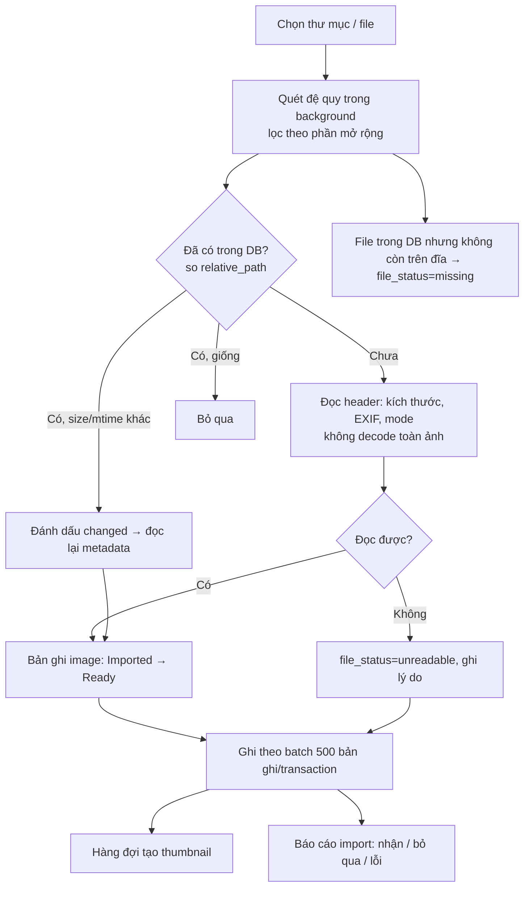
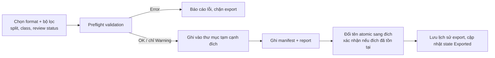

# 07 — Dataset & Import/Export

> Cấu trúc dataset, quy trình import, metadata ảnh, các format được hỗ trợ, validation, class mapping, export và round-trip.
> Trạng thái: **PROPOSAL** · Cập nhật: 2026-11-24 · Format YOLO đã xác minh với tài liệu Ultralytics ngày 2026-11-24 ([03](../01-tong-quan/03_research_and_references.md))

## 1. Mô hình dataset

- Một **project** có một hoặc nhiều **dataset source**. Mỗi source là một thư mục gốc (dataset root) trên ổ local hoặc ổ ngoài.
- App **không copy** ảnh. DB chỉ lưu `relative_path` so với root, cùng metadata (FR-DS-02, BR-06).
- Khi root thay đổi (đổi tên thư mục, đổi ký tự ổ đĩa, chuyển máy), người dùng **relink** root. Mọi ảnh được tìm lại theo đường dẫn tương đối, sau đó kiểm tra bằng `file_size` + `mtime` (+ `checksum` nếu có).

## 2. Định dạng ảnh hỗ trợ

| Định dạng | MVP | Ghi chú |
|---|:-:|---|
| JPEG (`.jpg`, `.jpeg`) | ✅ | Có xử lý EXIF orientation |
| PNG | ✅ | Có thể có alpha / 16-bit |
| BMP | ✅ | |
| TIFF (`.tif`, `.tiff`) | ✅ | Chỉ đọc page đầu; 16-bit được chuẩn hóa để hiển thị |
| WebP | ✅ | |
| GIF | ⚠️ | Chỉ đọc frame đầu, có cảnh báo |
| HEIC, RAW, DICOM | ❌ | Future, nếu có nhu cầu |
| Video | ❌ | Future (A-03) |

Thư viện đọc ảnh (PROPOSAL): **Pillow** để đọc metadata và EXIF, decode khi hiển thị; **OpenCV** chỉ dùng trong worker khi model cần. Bước 05 sẽ benchmark trước khi chốt.

## 3. Quy trình import



- Có tiến độ (số file đã quét) và có thể **hủy**. Hủy giữa chừng vẫn giữ những gì đã ghi, lần import sau sẽ tiếp tục.
- Checksum sha256 là tùy chọn, vì nó tốn I/O với dataset lớn. Tính nền ở mức ưu tiên thấp nếu được bật.
- Bỏ qua file ẩn/hệ thống (`Thumbs.db`, `.DS_Store`, thư mục `.git`) và symlink vòng lặp.
- Đường dẫn trên Windows: hỗ trợ đường dẫn dài và ký tự Unicode (thư mục gốc của dự án có dấu tiếng Việt). Đây là **trường hợp phải có test**.

## 4. Thumbnail cache

- Ảnh thumbnail cạnh dài 256 px, định dạng WebP hoặc JPEG, lưu tại `cache/thumbnails/<image_id[:2]>/<image_id>.webp`.
- Khóa cache gồm `image_id` + `mtime` + `size`. File nguồn đổi thì thumbnail cũ bị vô hiệu.
- Tạo nền theo thứ tự **ưu tiên ảnh đang hiển thị** trên lưới; có thể xóa toàn bộ và tạo lại.

## 5. Class mapping

| Tình huống | Hành vi |
|---|---|
| Import YOLO | Đọc `names` từ `data.yaml`. Không có file này thì người dùng phải nhập hoặc map thủ công các index |
| Import COCO | Map theo `categories[].name`. Có thể gộp vào class sẵn có hoặc tạo class mới |
| Kết quả model | Map class của checkpoint (ví dụ COCO-80) → class project; class không được map sẽ bị bỏ, có đếm số lượng |
| Export | Chỉ số class được **tính lúc export**, theo thứ tự `display_order` hoặc theo một mapping đã lưu (BR-07); ghi vào export manifest |

## 6. Ma trận khả năng của adapter

| Format | Task | Import | Export | Giữ được | Mất hoặc chuyển đổi |
|---|---|:-:|:-:|---|---|
| YOLO detect | BBox | MVP | MVP | class, bbox | confidence, provenance, review status (→ sidecar tùy chọn) |
| YOLO segment | Instance SEG | MVP | MVP | class, polygon | Lỗ (holes), nhiều mảnh/instance: **mất** (YOLO seg chỉ có 1 polygon/dòng) → cảnh báo, chọn mảnh lớn nhất hoặc nối mảnh (có tham số) |
| YOLO pose | Pose | MVP | MVP | class, bbox, keypoints, visibility (khi `kpt_shape[1]=3`) | Tên keypoint, skeleton (chỉ còn `flip_idx` trong `data.yaml`) |
| COCO detection | BBox | MVP | MVP | bbox, category, `iscrowd`, `area` | Provenance (→ `attributes` hoặc sidecar) |
| COCO instances | Instance SEG | MVP | MVP | polygon nhiều mảnh, RLE, `iscrowd` | Polygon có lỗ → xuất dạng RLE |
| COCO keypoints | Pose | MVP | MVP | keypoints `[x,y,v]`, `num_keypoints`, tên điểm, skeleton (1-based) | Confidence của từng keypoint (→ sidecar) |
| Pascal VOC | BBox | V1 | V1 | bbox, name, `difficult`, `truncated` | Polygon, keypoints |

## 7. Đặc tả format (tóm tắt)

### 7.1 YOLO (đã xác minh)
```
dataset/
├── data.yaml          # path, train, val, (test), names: {0: cat, ...}; pose: kpt_shape, flip_idx
├── images/{train,val}/xxx.jpg
└── labels/{train,val}/xxx.txt
```
- Detect: `class cx cy w h`, normalized về [0,1], class index bắt đầu từ 0. Ảnh không có object thì **không cần** file `.txt`. App vẫn ghi file rỗng nếu người dùng chọn tùy chọn "ghi file rỗng" (cần quyết định mặc định ở Bước 05).
- Segment: `class x1 y1 x2 y2 ... xn yn`, normalized, tối thiểu 3 điểm, mỗi dòng dài khác nhau.
- Pose: `class cx cy w h px1 py1 [v1] ...`, normalized. `data.yaml` có `kpt_shape: [K, 2|3]` và `flip_idx`.
- Ý nghĩa của giá trị visibility trong YOLO pose **chưa được tài liệu nêu rõ** (UNVERIFIED). Giả định theo quy ước COCO 0/1/2 và phải kiểm tra trong source `ultralytics` trước khi implement.
- Export YOLO **copy hoặc hardlink** ảnh vào `images/` (tùy chọn: copy / hardlink / chỉ ghi labels và danh sách đường dẫn). Mặc định là copy, vì đây là cách an toàn nhất.

### 7.2 COCO (đã xác minh với cocodataset.org, riêng `skeleton` 1-based còn UNVERIFIED)
- Một file JSON gồm `images[] {id, file_name, width, height}`, `annotations[] {id, image_id, category_id, bbox [x,y,w,h], area, iscrowd, segmentation, keypoints, num_keypoints}`, `categories[] {id, name, supercategory, keypoints, skeleton}`.
- `segmentation`: danh sách polygon khi `iscrowd=0`, RLE khi `iscrowd=1` (hoặc RLE dạng uncompressed / compressed).
- `keypoints`: mảng phẳng `[x1,y1,v1, ...]`, với `v` ∈ {0, 1, 2}. `skeleton` dùng chỉ số **1-based**.
- `width`/`height` được ghi theo oriented image; manifest có ghi chú rằng EXIF orientation đã được áp dụng.
- Bbox COCO tính từ góc trên-trái, tọa độ 0-indexed, nên khớp trực tiếp với canonical (chỉ cần đổi XYXY → XYWH). Nguồn ở [03 §4](../01-tong-quan/03_research_and_references.md).

## 8. Export



**Bộ lọc mặc định (BR-12):** chỉ gồm annotation `manual`, `imported`, `corrected` và `accepted`. Muốn kèm annotation `auto` chưa duyệt thì người dùng phải bật rõ ràng, và manifest sẽ ghi lại điều này.

**`export_manifest.json`** gồm: phiên bản app, `schema_version`, thời điểm export, format, bộ lọc, class mapping, keypoint schema, số ảnh/annotation, các chuyển đổi có mất mát và số annotation bị bỏ kèm lý do.

## 9. Validation (luật cho preflight)

| Mã | Luật | Mức |
|---|---|---|
| V-IMG-01 | File ảnh thiếu hoặc không đọc được | Error |
| V-CLS-01 | `category_id` null hoặc không tồn tại | Error |
| V-BOX-01 | Box có diện tích ≤ 0, hoặc `x_min ≥ x_max` | Error |
| V-BOX-02 | Box vượt ngoài ảnh (vượt quá sai số ε = 0.5 px) | Error (có tùy chọn clip có ghi nhận) |
| V-BOX-03 | Box nhỏ hơn `min_box_px` (cấu hình được) | Warning |
| V-SEG-01 | Polygon < 3 đỉnh, tự cắt, hoặc diện tích ≈ 0 | Error |
| V-SEG-02 | Polygon có lỗ mà format đích không hỗ trợ | Warning (kèm cách xử lý được áp dụng) |
| V-POS-01 | Số keypoint khác với schema | Error |
| V-POS-02 | Keypoint có `v > 0` nằm ngoài ảnh | Error |
| V-POS-03 | `num_keypoints = 0` nhưng vẫn có box pose | Warning |
| V-DUP-01 | Annotation ID trùng | Error |
| V-DUP-02 | Hai annotation cùng class có IoU > 0.95 | Warning (V1) |
| V-REV-01 | Còn annotation `unreviewed` hoặc `needs_attention` trong phạm vi export | Warning (hoặc Error nếu người dùng chọn chính sách nghiêm) |
| V-FS-01 | Trùng tên file đích sau khi làm phẳng thư mục | Error → tự đổi tên theo `image_id` nếu người dùng chọn |
| V-SPL-01 | Một ảnh nằm ở nhiều split | Error (V1) |

## 10. Round-trip test

Mỗi adapter bắt buộc có bộ test:
1. `canonical → export → import → canonical'`, so sánh `canonical ≈ canonical'` với dung sai 1e-3 px, trên các trường mà adapter khai báo là giữ được.
2. `file gốc → import → export → file'`, so sánh ngữ nghĩa (không so từng byte) với dữ liệu mẫu chuẩn (fixtures).
3. Trường hợp biên: ảnh không có nhãn, polygon có lỗ, nhiều mảnh, keypoint `v=0`, ảnh có EXIF orientation 6/8, tên file Unicode, class index không liên tục.
4. Trường bị mất phải xuất hiện đúng trong export report.
