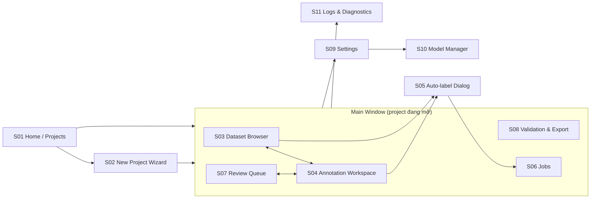

# 10 — Desktop UI/UX Specification

> Bản đồ màn hình, điều hướng, annotation workspace, phím tắt, trạng thái UI, thông điệp lỗi, accessibility và mô tả wireframe.
> Trạng thái: **PROPOSAL** · Cập nhật: 2026-11-24 · Framework: PySide6 (ADR-001)

## 1. Nguyên tắc UX

1. **Canvas là trung tâm.** Mọi thứ khác (panel, danh sách) có thể thu gọn để tối đa diện tích vẽ.
2. **Không bao giờ treo UI.** Tác vụ dài đều có tiến độ thật, hủy được và chạy nền.
3. **Thấy được độ tin cậy.** Annotation auto hiển thị khác annotation đã duyệt, kèm confidence.
4. **Bàn phím trước.** Annotator có thể làm cả ngày mà không cần chuột cho điều hướng và duyệt.
5. **Mọi điều khiển hiển thị đều làm được việc thật**, hoặc bị vô hiệu hóa kèm tooltip giải thích lý do.
6. **Mỗi màn hình có đủ trạng thái** loading / empty / error / success (và cancelled cho tác vụ dài).

## 2. Bản đồ màn hình



| ID | Màn hình | Mục đích | Tier |
|---|---|---|:-:|
| S01 | Home / Projects | Danh sách project gần đây, mở, tạo, archive | MVP |
| S02 | New Project Wizard | Tên, workspace, task, class/keypoint schema, chọn dataset root | MVP |
| S03 | Dataset Browser | Lưới thumbnail, lọc, thống kê, import, relink | MVP |
| S04 | Annotation Workspace | Canvas, công cụ, danh sách annotation, thuộc tính | MVP |
| S05 | Auto-label Dialog | Chọn task/model/params/scope, xem quyết định của router, consent remote | MVP |
| S06 | Jobs | Hàng đợi, tiến độ, tài nguyên, log, retry/resume/cancel | MVP |
| S07 | Review Queue | Duyệt theo bộ lọc, Accept/Reject/Edit nhanh | MVP |
| S08 | Validation & Export | Chạy validator, xem lỗi, cấu hình và chạy export, lịch sử export | MVP |
| S09 | Settings | General, Paths, Compute, Hardware, Remote, Shortcuts, Appearance | MVP |
| S10 | Model Manager | Model, trạng thái tải, license, custom checkpoint, benchmark | MVP |
| S11 | Logs & Diagnostics | Xem log, xuất gói chẩn đoán đã redact | MVP |

## 3. Main window

```
┌────────────────────────────────────────────────────────────────────────────┐
│ Menu: File  Edit  View  Dataset  Annotate  AI  Jobs  Tools  Help           │
├────┬───────────────────────────────────────────────────────────┬───────────┤
│ Nav│  Toolbar: [Select V][BBox B][Polygon P][Keypoint K][SAM S]│ Right dock│
│ ▣ D│           Class: [person ▼]   Zoom 100%  [Auto-label ⚡]   │ ┌───────┐ │
│ ▣ A│ ┌───────────────────────────────────────────────────────┐ │ │Annot. │ │
│ ▣ R│ │                                                       │ │ │ list  │ │
│ ▣ E│ │                   CANVAS                              │ │ ├───────┤ │
│ ▣ J│ │                                                       │ │ │Props  │ │
│    │ └───────────────────────────────────────────────────────┘ │ ├───────┤ │
│    │  Filmstrip: ◀ [thumb][thumb][THUMB][thumb][thumb] ▶ 152/4310│ │Classes│ │
├────┴───────────────────────────────────────────────────────────┴───────────┤
│ Status: ● Saved | Image: Needs Review | GPU: RTX… 3.1/8 GB | Job: 42% (210/500) ETA 3m │
└────────────────────────────────────────────────────────────────────────────┘
```
Nav bên trái: **D**ataset · **A**nnotate · **R**eview · **E**xport · **J**obs.

## 4. Annotation Workspace (S04)

### 4.1 Công cụ

| Công cụ | Phím | Hành vi |
|---|:-:|---|
| Select / Edit | `V` | Chọn, kéo, resize box; kéo đỉnh polygon; kéo keypoint |
| BBox | `B` | Kéo để vẽ; `Shift` giữ tỷ lệ; nhả chuột là tạo xong |
| Polygon | `P` | Click thêm đỉnh; `Enter` hoặc click đỉnh đầu để đóng; `Backspace` xóa đỉnh vừa thêm; `Esc` hủy |
| Keypoint | `K` | Đặt điểm theo thứ tự schema (hiển thị tên điểm tiếp theo); `N` bỏ qua điểm (v=0); `O` đổi visibility của điểm đang chọn |
| SAM assist | `S` | Click trái = điểm dương, `Alt`+click = điểm âm, kéo = box prompt; `Enter` chấp nhận mask → polygon; `Tab` đổi giữa các mask ứng viên |
| Pan | `Space` + kéo, hoặc nút chuột giữa | |
| Zoom | Cuộn chuột / `Ctrl +/-` / `Ctrl 0` (vừa khung) / `Ctrl 1` (1:1) | Zoom quanh vị trí con trỏ |

### 4.2 Hiển thị annotation

| Trạng thái | Kiểu hiển thị |
|---|---|
| `manual` / `accepted` / `corrected` | Nét liền, màu của class |
| `auto` + `unreviewed` | Nét đứt, kèm nhãn `class 0.87` |
| `needs_attention` | Viền cam nhấp nháy nhẹ (tắt được trong Accessibility), có icon ⚠ |
| `rejected` | Ẩn (bật lại qua View → Show rejected) |
| Đang chọn | Handle ở các góc/đỉnh, viền dày hơn |
| Mask | Fill bán trong suốt (opacity chỉnh bằng `[`/`]`) |
| Skeleton | Cạnh nối giữa các điểm `v>0`; điểm `v=1` vẽ rỗng, `v=2` vẽ đặc |

### 4.3 Panel bên phải
- **Annotation list:** loại, class, confidence, origin, review status; click để chọn trên canvas; lọc nhanh.
- **Properties:** class, attributes (occluded, truncated, crowd, note), provenance (model, job, thời gian). Trường chỉ đọc hiển thị màu xám.
- **Classes:** danh sách class kèm số lượng trên ảnh; phím `1`–`9` chọn nhanh class.

## 5. Phím tắt chung

| Phím | Hành động |
|---|---|
| `D` / `→`, `A` / `←` | Ảnh tiếp theo / trước |
| `Ctrl+Z` / `Ctrl+Shift+Z` (hoặc `Ctrl+Y`) | Undo / Redo |
| `Del` | Xóa annotation đang chọn |
| `Ctrl+D` | Nhân bản annotation |
| `Ctrl+S` | Lưu ngay (bình thường autosave đã lo việc này) |
| `H` | Ẩn/hiện mọi annotation |
| `L` | Khóa/mở khóa annotation đang chọn |
| `Ctrl+A` | Chọn tất cả annotation trong ảnh |
| `Enter` (ở Review) | Accept annotation hoặc ảnh |
| `R` (ở Review) | Reject |
| `E` (ở Review) | Chuyển sang chế độ sửa |
| `U` | Đánh dấu "không chắc chắn" (needs_attention) |
| `Ctrl+Shift+A` | Mở Auto-label dialog |
| `F1` | Bảng phím tắt |

Có thể tùy biến phím tắt trong S09 → Shortcuts. Phím trùng nhau sẽ bị phát hiện và cảnh báo.

## 6. Auto-label Dialog (S05)

```
┌ Auto-label ──────────────────────────────────────────────┐
│ Task:   (•) BBox  ( ) Segment  ( ) Pose                   │
│ Model:  [YOLO26n Detect ▼]   ✓ ready · AGPL-3.0 ⓘ         │
│ Pipeline: [ ] Refine mask bằng SAM 2 (chỉ với Segment)    │
│ Scope:  (•) 500 ảnh đang lọc  ( ) Ảnh hiện tại  ( ) Tất cả│
│ Merge:  [Chỉ ảnh chưa có nhãn ▼]                          │
│ Params: conf [0.25] iou [0.70] imgsz [640] ▸ Nâng cao     │
│ Class mapping: person→worker, 79 class khác: bỏ  [Sửa…]   │
│──────────────────────────────────────────────────────────│
│ Thiết bị: LOCAL_GPU (cuda:0)                              │
│  • GPU còn 7.1 GB trống; profile ước lượng cần ~? GB      │
│  ⚠ Ước lượng chưa được đo trên máy này [Benchmark]         │
│ Chế độ: [Auto ▼]                                           │
│──────────────────────────────────────────────────────────│
│                         [Hủy]   [Chạy]                    │
└──────────────────────────────────────────────────────────┘
```

- Nút **Chạy** bị vô hiệu hóa nếu model–task không tương thích, model chưa tải xong, hoặc class mapping chưa xong. Tooltip luôn nêu lý do.
- Khi router chọn REMOTE_KAGGLE, dialog thêm bước **consent**: danh sách và dung lượng dữ liệu sẽ gửi, đích đến (tài khoản Kaggle của người dùng), thời gian lưu, cảnh báo về quota và về việc không thể hủy kernel đang chạy (xem [09 §4](../02-kien-truc/09_kaggle_remote_worker.md)). Có checkbox "Tôi hiểu và đồng ý" cho riêng job này.

## 7. Review Queue (S07)

- Bộ lọc: review status, origin, class, khoảng confidence, model, job, có lỗi validation.
- Có hai chế độ: **theo ảnh** (mở ảnh trong workspace, duyệt từng annotation) và **theo annotation** (lưới crop nhỏ của từng annotation để duyệt nhanh hàng loạt).
- Thao tác hàng loạt: Accept tất cả trên ngưỡng confidence (có xác nhận và hiển thị số lượng bị ảnh hưởng), Reject tất cả dưới ngưỡng.
- Hiển thị tiến độ review coverage của dataset.

## 8. Jobs (S06)

| Cột | |
|---|---|
| Job | ID ngắn, task, model |
| Mode | LOCAL_GPU / LOCAL_CPU / REMOTE_KAGGLE |
| Trạng thái | Theo state machine ([04 §9](../02-kien-truc/04_system_architecture.md)) |
| Tiến độ | `done/total` ảnh và chunk; throughput đo được; ETA (chỉ hiện khi có số đo) |
| Hành động | Pause (dừng ở ranh giới chunk) / Resume / Cancel / Retry / Mở log / Mở review |

Khi job remote đang chạy, UI chỉ hiển thị trạng thái mà Kaggle trả về (QUEUED/RUNNING), **không** bịa % tiến độ.

## 9. Trạng thái UI chuẩn

| Trạng thái | Quy ước |
|---|---|
| Loading | Skeleton cho lưới và danh sách; spinner nhỏ cho thao tác ngắn; không làm nhảy layout |
| Empty | Minh họa + hướng dẫn + nút hành động (ví dụ "Chưa có ảnh — [Import thư mục]") |
| Error | Thông điệp dễ hiểu + mã lỗi + nút hành động (Thử lại / Mở log / Hướng dẫn) |
| Success | Toast ngắn 3–5 s; không chặn thao tác |
| Cancelled | Nêu rõ những gì đã hoàn thành và những gì chưa |
| Dirty / Saved | Chấm trạng thái trên status bar: ● Đang lưu / ✓ Đã lưu / ⚠ Lỗi lưu |

## 10. Thông điệp lỗi (mẫu)

| Mã | Thông điệp hiển thị | Hành động |
|---|---|---|
| E-DS-004 | "Không tìm thấy 37 ảnh. Có thể thư mục dataset đã bị di chuyển." | [Relink thư mục] [Xem danh sách] |
| E-MDL-002 | "Model YOLO26n Segment không hỗ trợ task Pose." | [Chọn model Pose] |
| E-MDL-010 | "Chưa có quyền truy cập SAM 3 trên Hugging Face." | [Hướng dẫn xin quyền] |
| E-CMP-003 | "GPU hết bộ nhớ ngay cả với batch 1." | [Dùng model nhỏ hơn] [Chạy CPU] [Dùng Kaggle] |
| E-RMT-001 | "Không xác thực được Kaggle CLI." | [Hướng dẫn cấu hình token] |
| E-RMT-007 | "Kết quả từ Kaggle không khớp checksum — chưa import." | [Tải lại] [Mở thư mục job] |
| E-IO-005 | "Thư mục export đã tồn tại." | [Ghi đè] [Chọn thư mục khác] |

Không hiển thị stack trace, đường dẫn cache nội bộ hay token trong thông điệp.

## 11. Accessibility

- Mọi chức năng đều làm được bằng bàn phím. Thứ tự Tab hợp lý, focus có viền rõ ràng.
- Đặt `accessibleName` và `accessibleDescription` (Qt) cho các nút chỉ có icon.
- Bảng màu class mặc định thân thiện với người mù màu. Thông tin không chỉ truyền đạt bằng màu: trạng thái auto dùng nét đứt + nhãn chữ.
- Tôn trọng scale DPI của Windows (high-DPI), có cỡ chữ UI tùy chỉnh, có thể tắt hiệu ứng nhấp nháy.
- Có Light và Dark theme. Màu được định nghĩa thành token trong một file theme (QSS + palette).

**Token màu (PROPOSAL, theo nhận diện thương hiệu ở Bước 07):**

| Token | Light | Dark |
|---|---|---|
| `primary` | Navy `#0E4A63` | Teal `#3BB8C3` |
| `accent` | Orange `#F28C1B` | `#FFB547` |
| `surface` | Cream `#FCF6EC` | `#14232B` |
| `surface-muted` | `#F3E3CC` | `#1C2F38` |
| `info` | Teal `#1E8FA8` | `#3BB8C3` |

## 12. Hiệu năng UI

- Canvas dùng `QGraphicsView` / `QGraphicsScene`. Mỗi annotation là một `QGraphicsItem`; ảnh hiển thị ở dạng pixmap đã scale phù hợp. Cần benchmark với 500+ annotation (NFR-PERF-03).
- Lưới dataset dùng `QListView` + model ảo (`QAbstractListModel`) có tải lười và phân trang từ DB (NFR-PERF-04).
- Ảnh tiếp theo/trước được **prefetch** trong background để chuyển ảnh nhanh.
- Không cập nhật UI theo từng ảnh khi job chạy nhanh: gộp sự kiện tiến độ, tối đa 10 lần/s.
