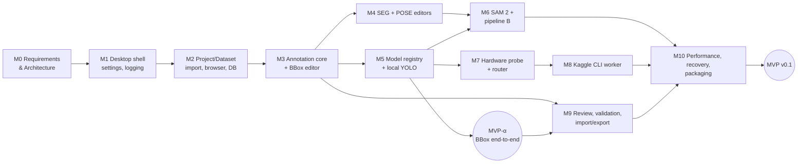

# 13 — Implementation Roadmap

> Milestone, đầu việc, dependency, Definition of Done, rủi ro và giả định về khối lượng.
> Trạng thái: **PROPOSAL** · Cập nhật: 2026-11-24 · Không đặt ngày vì chưa có thông tin về nguồn lực. Khối lượng ghi theo cỡ tương đối (S/M/L/XL).

## 1. Đường găng và thứ tự

**Đường MVP ngắn nhất (MVP-α):** M0 → M1 → M2 → M3 → M5 (chỉ YOLO detect) → một phần M9 (review cơ bản + export YOLO detect). Lát cắt này đi qua đủ mọi tầng kiến trúc (UI ↔ use case ↔ SQLite ↔ worker process ↔ exporter), giúp phát hiện sai lầm kiến trúc sớm.

## 2. Milestone

### M0 — Requirements, research, architecture *(đang thực hiện)*
- **Đầu việc:** bộ tài liệu 00–19, Bước 02 (sơ đồ chi tiết), Bước 03 (database), duyệt ADR, trả lời 5 câu hỏi mở.
- **DoD:** chủ dự án duyệt phạm vi MVP và ADR-001 → 009; quyết định license (ADR-010) không còn ở trạng thái blocked.
- **Rủi ro:** quyết định license chậm sẽ chặn M5.

### M1 — Desktop shell · M
- **Đầu việc:** uv workspace, `bootstrap.py`, main window + điều hướng, theme light/dark, settings (pydantic + platformdirs), logging + redact, `excepthook` + crash marker, diagnostics, background task abstraction, CI (ruff, mypy, pytest, import-linter).
- **Phụ thuộc:** M0.
- **DoD:** app khởi động trên Windows; diagnostics chạy được; test smoke khởi động pass trong CI (Qt offscreen); vi phạm ranh giới import làm CI fail.

### M2 — Project, dataset, metadata store · L
- **Đầu việc:** schema SQLite v1 + migration runner (theo Bước 03), create/open/close project, import đệ quy có hủy, metadata + EXIF, thumbnail cache, dataset browser ảo hóa, bộ lọc, relink, thống kê, class/keypoint schema CRUD.
- **Phụ thuộc:** M1, kết quả Bước 03.
- **DoD:** AC-01 pass; import 50k ảnh tổng hợp mà UI không treo (đo và ghi số); test đường dẫn Unicode/dài pass.

### M3 — Annotation core + BBox · L
- **Đầu việc:** `autolabel_core` (schema, geometry, states, validation cơ bản); canvas `QGraphicsView`; tool Select/BBox; undo/redo; autosave + flush; annotation list/properties; phím tắt.
- **Phụ thuộc:** M2.
- **DoD:** geometry đạt coverage ≥ 90% với edge case; kill test AC-07 pass với BBox; benchmark 500 box/ảnh đạt hoặc có ghi nhận rõ.

### M4 — SEG + POSE editors · L
- **Đầu việc:** tool Polygon (thêm/xóa/kéo đỉnh, nhiều mảnh), mask overlay từ RLE, tool Keypoint + skeleton + visibility, preset COCO-17, editor cho keypoint schema.
- **Phụ thuộc:** M3.
- **DoD:** tạo và sửa được cả 3 loại annotation; validator cho polygon/keypoint có test.

### M5 — Model registry + local YOLO · L
- **Đầu việc:** registry + descriptor, model manager (tải có consent + checksum), giao thức worker, worker `serve`/`run`, adapter YOLO detect/segment/pose, orchestrator + job queue + chunk, class mapping dialog, merge policy (BR-02), dialog Auto-label, Jobs panel.
- **Phụ thuộc:** M3 (và M4 cho segment/pose), **ADR-010 (license)**.
- **DoD:** AC-02, AC-03 pass; worker crash → job INTERRUPTED; cancel dừng ở ranh giới chunk; provenance đầy đủ.

### M6 — SAM 2 + pipeline · M
- **Đầu việc:** adapter `sam2.prompt` (qua transformers), phiên interactive (giữ embedding), tool SAM assist, pipeline B (YOLO → SAM 2), mask → polygon có tham số.
- **Phụ thuộc:** M4, M5.
- **DoD:** interactive SAM chạy local trên GPU và CPU (ghi độ trễ đo được); pipeline B có contract test.

### M7 — Hardware probe + compute router · M
- **Đầu việc:** probe (NVML, torch, smoke test), capability profile + benchmark, router (pure function), chính sách OOM, resource monitor, Settings → Compute/Hardware, dialog lý do chọn mode.
- **Phụ thuộc:** M5 (có thể làm song song với M6).
- **DoD:** unit test router cho mọi nhánh của sơ đồ; AC-04 pass; test OOM bằng adapter giả.

### M8 — Kaggle CLI remote worker · L
- **Đầu việc:** interface `RemoteComputeProvider`, mock provider, Kaggle provider (kiểm tra CLI/xác thực, packager, push với timeout, poller, collector, validator, cleanup), consent dialog, resume theo chunk.
- **Phụ thuộc:** M7; quyết định về rủi ro điều khoản Kaggle (§16).
- **DoD:** toàn bộ kịch bản mock pass trong CI; AC-05 pass với mock; một lần chạy thật với tài khoản Kaggle (khi được phép) được ghi vào báo cáo.

### M9 — Review, validation, import/export · L
- **Đầu việc:** Review queue (hai chế độ, thao tác hàng loạt), validator đầy đủ các luật V-*, export preflight, exporter/importer YOLO detect/seg/pose và COCO detection/instances/keypoints, export manifest, lịch sử export.
- **Phụ thuộc:** M3 (một phần có thể làm sớm cho MVP-α), M4.
- **DoD:** round-trip test pass cho mọi adapter; AC-06, AC-08 pass.

### M10 — Performance, recovery, packaging · L
- **Đầu việc:** benchmark và tối ưu (NFR-PERF), crash recovery flow, backup/restore, dọn cache, Runtime Manager, bản portable Windows (PyInstaller one-folder), THIRD_PARTY_NOTICES.
- **Phụ thuộc:** M6, M8, M9.
- **DoD:** bản portable chạy được trên một máy Windows sạch (có và không có GPU); checklist ở [19](19_project_readiness_checklist.md) đạt cho MVP.

### Sau MVP (V1)
SAM 3 (nếu license/quyền truy cập ổn), DINOv2 similarity/dedup, Pascal VOC, brush mask, polygon có lỗ trên UI, split train/val/test, installer, Linux chính thức, project bundle.

## 3. Definition of Done chung (mọi issue)

- [ ] Acceptance criteria của issue đạt, có bằng chứng (test, log, ảnh chụp màn hình).
- [ ] Unit/integration test mới pass; CI xanh (lint, type, import-linter).
- [ ] Không chạy tác vụ nặng trên UI thread; không có secret trong code hay log.
- [ ] Tài liệu liên quan trong `docs/` đã cập nhật; ADR mới nếu có quyết định kiến trúc.
- [ ] Đã được review.

## 4. Rủi ro của roadmap

| Rủi ro | Ảnh hưởng | Giảm thiểu |
|---|---|---|
| License Ultralytics (AGPL) chưa được quyết định | Chặn M5 | Đưa ra quyết định ở M0; adapter tách rời nên có thể đổi detector |
| SAM 2 trên Windows native | M6 | Dùng implementation của `transformers`; spike sớm trong M5 |
| Hiệu năng canvas với ảnh lớn hoặc nhiều annotation | M3/M4 | Spike `QGraphicsView` ngay đầu M3 |
| Kaggle CLI hoặc điều khoản thay đổi | M8 | Provider interface + mock; pin phiên bản CLI |
| Kích thước gói torch + CUDA | M10 | Runtime Manager tải torch sau khi cài (ADR-011) |
| Phạm vi phình to (SAM 3, DINO, video) | Toàn bộ | Đã để ở V1/Future; mọi thay đổi phạm vi phải có ADR |

## 5. Giả định về khối lượng

- Cỡ S/M/L/XL là tương đối (S ≈ vài ngày, M ≈ 1–2 tuần, L ≈ 2–4 tuần cho **một** developer có kinh nghiệm Qt + PyTorch). Đây là **ASSUMPTION** thô để sắp xếp thứ tự, không phải cam kết tiến độ.
- Ước lượng chính xác sẽ được làm ở Bước 04, khi tách thành issue.
