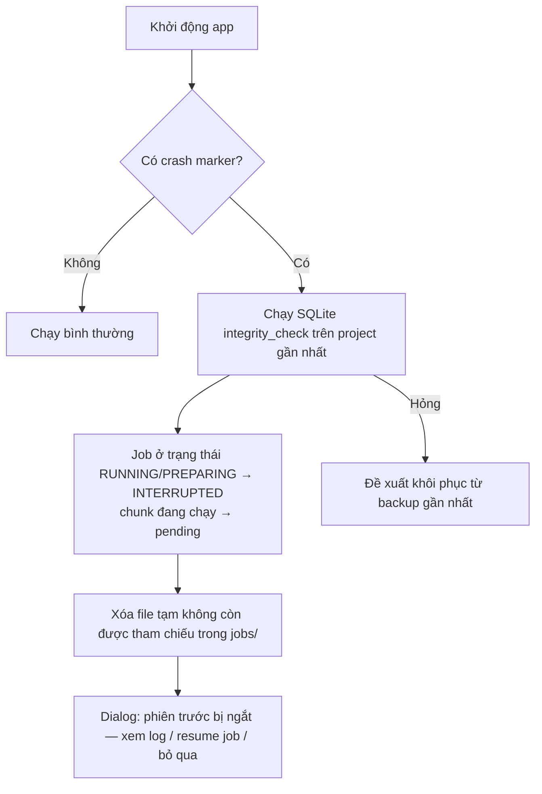

# 15 — Packaging, Release & Operations

> Đóng gói Windows, quản lý model asset, cache, cập nhật, log, crash recovery, backup và quy trình phát hành.
> Trạng thái: **PROPOSAL** · Cập nhật: 2026-11-24 · Phiên bản công cụ đã xác minh ngày 2026-11-24 ([03](../01-tong-quan/03_research_and_references.md))

## 1. Bài toán

- PyTorch kèm CUDA khiến gói ứng dụng nặng **nhiều GB**. Theo các nguồn cộng đồng (UNVERIFIED) một bản bundle torch+CUDA khoảng ~3 GB. PyInstaller one-file còn gặp giới hạn kích thước archive và phải giải nén mỗi lần khởi động.
- Phiên bản torch phù hợp **phụ thuộc vào driver và GPU** của từng máy: torch 2.15 cần driver ≥ 580 và GPU Turing trở lên, máy cũ phải dùng 2.14, máy không có GPU dùng bản CPU ([11 §5](../05-phat-trien/11_environment_and_setup.md)). Một bản bundle cố định không phù hợp cho mọi máy.

## 2. Quyết định: "thin app + managed runtime" (ADR-011, PROPOSAL)

| Thành phần | Cách phân phối |
|---|---|
| **App** (PySide6 + core + studio) | PyInstaller **one-folder** (không dùng one-file). Gói nhỏ, khởi động nhanh |
| **Worker runtime** (Python 3.12 + torch + thư viện model) | **Runtime Manager** của app dùng `uv` để tạo môi trường trong `%LOCALAPPDATA%\AutoLabelStudio\runtimes\<id>\`, chọn bản CPU / cu12x / cu13x theo NVML, **sau khi người dùng đồng ý** (hiển thị dung lượng cần tải) |
| **Model weights** | Model Manager tải khi người dùng bấm tải, có kiểm tra checksum ([05 §8](../02-kien-truc/05_model_and_inference_design.md)) |
| **Kaggle CLI** | Runtime Manager cài thành tool riêng (`kaggle>=2.2.5`) khi người dùng bật remote |

**Phương án thay thế:**
- (B) Bundle sẵn torch-CPU trong app, tùy chọn nâng cấp lên CUDA. Cách này chạy offline ngay sau khi cài, nhưng gói lớn hơn.
- (C) Bản offline đầy đủ: một bundle cho mỗi biến thể CUDA. Gói rất lớn, khó bảo trì.
- **Nuitka** có tiềm năng cho hiệu năng khởi động, nhưng chỉ hỗ trợ Python ≤ 3.14 và có báo cáo lỗi khi build torch-CUDA one-file trên Windows. Đánh giá lại ở M10.

Việc tách app khỏi runtime còn giúp **tách ranh giới phân phối** giữa mã của sản phẩm và các thành phần bên thứ ba (đặc biệt là `ultralytics` AGPL). Tuy nhiên điều này **không tự động giải quyết nghĩa vụ license**, xem [16](16_security_privacy_and_licenses.md).

## 3. Quy trình đóng gói (kế hoạch cho M10)

1. `uv sync --frozen` trên máy build Windows sạch.
2. PyInstaller one-folder với spec trong `packaging/` (hook cho PySide6, chỉ collect các plugin Qt cần dùng).
3. Đính kèm: `LICENSE`, `THIRD_PARTY_NOTICES.md`, LGPL notice của Qt/PySide6 (cho phép thay thế thư viện Qt; one-folder đáp ứng điều này dễ hơn).
4. Ký số (code signing) để giảm cảnh báo SmartScreen. Cần chứng chỉ, đây là quyết định của chủ dự án.
5. Kiểm tra trên máy sạch: (a) không GPU, (b) GPU cũ, (c) GPU Turing+ với driver mới.
6. V1: installer (Inno Setup hoặc WiX, sẽ đánh giá sau), có shortcut, gỡ cài đặt sạch (tùy chọn giữ hoặc xóa dữ liệu người dùng).

## 4. Quản lý cache và dung lượng

| Cache | Vị trí | Dọn |
|---|---|---|
| Model weights | `%LOCALAPPDATA%\AutoLabelStudio\models\` | Model Manager: xóa từng model, hiển thị dung lượng |
| Worker runtimes | `...\runtimes\` | Runtime Manager: xóa runtime không dùng |
| Thumbnail | `<project>/cache/thumbnails/` | Settings → Storage: xóa (tạo lại được) |
| Thư mục job | `<project>/jobs/` | Tự dọn sau N ngày (mặc định 7) |
| Log | `...\logs\` | Xoay vòng: 10 file × 10 MB (PROPOSAL) |

Cảnh báo khi dung lượng trống dưới ngưỡng (mặc định 5 GB) trên ổ chứa workspace hoặc cache.

## 5. Cập nhật

- **MVP:** cập nhật thủ công (tải bản mới, giải nén). App kiểm tra `schema_version` của project và migrate có backup.
- **V1:** kiểm tra phiên bản mới (chỉ hỏi metadata phiên bản, có thể tắt), người dùng tự bấm cập nhật. Không có auto-update ngầm.
- Runtime được cập nhật độc lập với app. Mỗi phiên bản app khai báo dải phiên bản runtime tương thích (`autolabel_worker` phải khớp phiên bản giao thức).

## 6. Log và chẩn đoán

- Log dạng JSON-lines có `timestamp`, `level`, `component`, `job_id`, `correlation_id`, `message`, `context`.
- **Redact filter** áp dụng cho mọi handler: chuỗi giống token, giá trị của các biến môi trường nhạy cảm, đường dẫn home (tùy chọn ẩn tên người dùng).
- **Gói chẩn đoán:** ZIP gồm log gần nhất, hardware report, phiên bản và cấu hình (đã redact). Người dùng xem trước nội dung rồi mới lưu. App không tự gửi gói này đi đâu.

## 7. Crash recovery

- Autosave dùng debounce (mặc định 1 s) cộng với flush khi chuyển ảnh hoặc đóng app. SQLite ở chế độ WAL.
- Ghi file theo kiểu atomic: ghi ra `*.tmp` → `fsync` → `os.replace`.

## 8. Backup và restore

| Loại | Khi nào | Nội dung |
|---|---|---|
| Trước migration | Tự động | Snapshot `project.db` (SQLite backup API) |
| Định kỳ | Mặc định mỗi lần đóng project, giữ 5 bản | `project.db` + `project.json` |
| Thủ công / project bundle | Người dùng bấm (V1) | ZIP metadata + annotation + mask file (không kèm ảnh nguồn) |

Chỉ được nói "backup hoạt động" sau khi **restore đã được test** (xem [14 §7](../05-phat-trien/14_testing_and_quality_strategy.md)). Bước 03 sẽ viết runbook chi tiết.

## 9. Quy trình phát hành

1. Chốt phạm vi phiên bản; checklist [19](../06-ke-hoach/19_project_readiness_checklist.md) đạt.
2. Cập nhật `CHANGELOG.md` (Keep a Changelog + SemVer: `0.1.0` cho MVP).
3. Chạy CI đầy đủ, kèm test thủ công có marker `gpu`/`model`/`kaggle` (nếu được phép), rồi lưu báo cáo.
4. Build trên máy sạch, smoke test trên 3 cấu hình máy (§3.5).
5. Audit license và secret; cập nhật `THIRD_PARTY_NOTICES.md`.
6. Gắn tag, phát hành (repo mặc định ở chế độ private, xem Bước 07), có ghi chú phát hành nêu rõ giới hạn đã biết.
