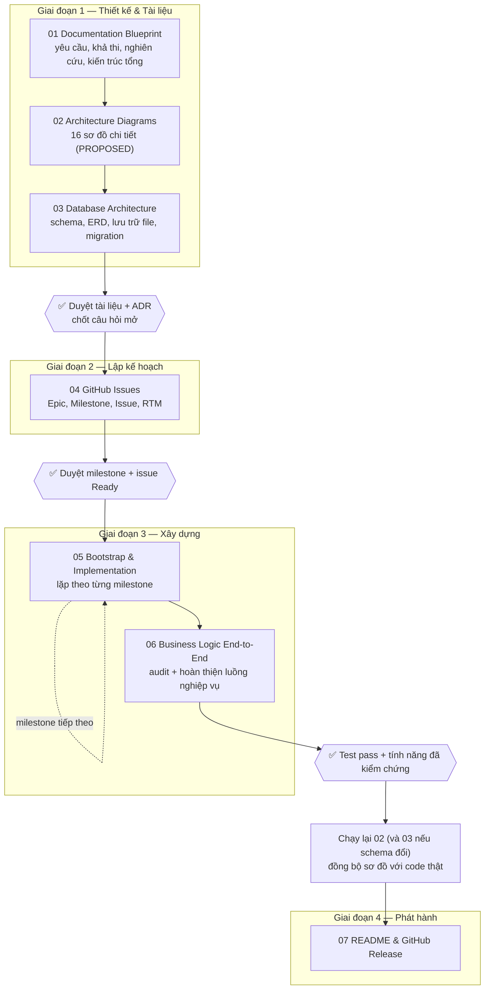

# Lộ trình Prompts — AutoLabel Studio

Thư mục này chứa 7 master prompt để đưa dự án từ ý tưởng tới phát hành, chia thành 4 giai đoạn.
**Chạy theo đúng thứ tự số.** Hết mỗi giai đoạn phải qua cổng duyệt (✅) thì mới sang giai đoạn sau.

```
steps/
├── 01-thiet-ke/          Giai đoạn 1 — Thiết kế & Tài liệu (chưa viết code)
│   ├── 01_Documentation_Engineering_Blueprint.md
│   ├── 02_System_Architecture_Diagrams.md
│   └── 03_Database_Architecture.md
├── 02-lap-ke-hoach/      Giai đoạn 2 — Lập kế hoạch
│   └── 04_GitHub_Issue_Engineering_System.md
├── 03-xay-dung/          Giai đoạn 3 — Xây dựng
│   ├── 05_Desktop_App_Bootstrap_Implementation.md
│   └── 06_Business_Logic_EndToEnd.md
└── 04-phat-hanh/         Giai đoạn 4 — Phát hành
    └── 07_README_Generator_GitHub_Release.md
```

## Sơ đồ thứ tự thực hiện



## Chi tiết từng bước

| Bước | Prompt | Đầu vào | Đầu ra chính | Điều kiện để qua bước |
|:---:|--------|---------|--------------|------------------------|
| 01 | Documentation & Engineering Blueprint | Ý tưởng, ràng buộc | `README.md`, `docs/01-tong-quan/` … `docs/07-van-hanh/` (tài liệu 00–19, mục lục: `docs/README.md`) | MVP, non-goals và tối đa 5 câu hỏi mở đã được trả lời |
| 02 | System Architecture & Diagrams | `docs/` từ bước 01 | `docs/02-kien-truc/architecture/` + `diagrams/*.mmd` + ADR | Sơ đồ Mermaid hợp lệ, ranh giới local/remote rõ ràng |
| 03 | Database Architecture | Bước 01–02 | `docs/03-du-lieu/database/` (schema, ERD, data dictionary, migration) | Chốt được lựa chọn DB và canonical annotation schema |
| ✅ | **Cổng duyệt thiết kế** | | | Chủ dự án duyệt tài liệu, chuyển ADR sang trạng thái Accepted |
| 04 | GitHub Issue Engineering | Tài liệu đã duyệt | Epic/Milestone/Issue, `docs/06-ke-hoach/project-management/`, issue templates | Có ít nhất 1 issue ở trạng thái Ready, không có dependency vòng tròn |
| ✅ | **Cổng duyệt kế hoạch** | | | Duyệt milestone và quyền tạo issue trên GitHub |
| 05 | Bootstrap & Implementation | Docs + issues | Codebase, môi trường, test | Mỗi milestone: test pass, báo cáo handover |
| 06 | Business Logic End-to-End | Codebase bước 05 | Luồng nghiệp vụ end-to-end, báo cáo audit & test | Checklist acceptance của prompt 06 đạt |
| ✅ | **Cổng chất lượng** | | | Test thật pass, không còn dữ liệu giả trong luồng chính |
| ↻ | Chạy lại 02 (+03) | Code thật | Sơ đồ đã đồng bộ code, hết nhãn PROPOSED | Không còn mâu thuẫn giữa sơ đồ và code |
| 07 | README & GitHub Release | Mọi thứ ở trên | README, assets SVG, LICENSE, commit/push | Kiểm tra secret, có approval của người dùng trước khi push |

## Bảng đối chiếu số cũ → số mới

| Số mới | Số cũ | File |
|:---:|:---:|------|
| 01 | 01 | `01-thiet-ke/01_Documentation_Engineering_Blueprint.md` |
| 02 | 06 | `01-thiet-ke/02_System_Architecture_Diagrams.md` |
| 03 | 07 | `01-thiet-ke/03_Database_Architecture.md` |
| 04 | 03 | `02-lap-ke-hoach/04_GitHub_Issue_Engineering_System.md` |
| 05 | 02 | `03-xay-dung/05_Desktop_App_Bootstrap_Implementation.md` |
| 06 | 05 | `03-xay-dung/06_Business_Logic_EndToEnd.md` |
| 07 | 04 | `04-phat-hanh/07_README_Generator_GitHub_Release.md` |

**Lý do đổi thứ tự:**
- Thiết kế database (cũ 07) phải xong **trước** khi code, vì prompt bootstrap yêu cầu "thực hiện theo database/schema được duyệt".
- Tạo issue/milestone (cũ 03) phải có **trước** bootstrap (cũ 02), vì bootstrap chỉ "triển khai milestone được giao". Ngoài ra issue phải bao quát cả kiến trúc lẫn database.
- Sơ đồ kiến trúc (cũ 06) được đưa lên giai đoạn thiết kế dưới dạng PROPOSED, rồi chạy lại trước khi phát hành để README phản ánh đúng code thật.
- Business logic (cũ 05) audit và mở rộng một codebase **đã có**, nên nó đứng ngay sau bootstrap.

## Cách chạy một bước

1. Mở file prompt của bước đó và copy toàn bộ nội dung prompt.
2. Dán vào Claude Code ở thư mục gốc dự án.
3. Theo `CLAUDE.md`, Claude sẽ đọc các skill trước khi làm.
4. Kiểm tra đầu ra theo cột "Điều kiện để qua bước" rồi mới chạy bước tiếp theo.

## Nguyên tắc kiến trúc xuyên suốt mọi bước

| Vấn đề | Quyết định định hướng |
|---|---|
| Giao diện chính | Desktop application |
| Xử lý mặc định | Local-first |
| BBox | YOLO Detection |
| SEG | YOLO Segmentation, SAM 2/SAM 3 prompt-assisted |
| POSE | YOLO Pose |
| DINOv2/v3 | Embedding, similarity, feature workflows phù hợp |
| GPU local đủ | Local GPU |
| Không có GPU / không đủ tài nguyên | CPU nếu khả thi, nếu không thì remote |
| GPU local không đáp ứng | Kaggle CLI worker |
| Giao diện Kaggle | Không có; chỉ remote CLI/code execution |
| Annotation truth | Kết quả auto-label phải qua human review |
| Lưu trữ | Dataset nằm ở local, metadata/project store riêng |
| Export | Adapter riêng cho từng format + round-trip tests |

**Lưu ý kỹ thuật:** không gộp YOLO, SAM và DINO vào chung một nhóm "model auto-label" rồi gọi chung một hàm, vì vai trò của chúng khác nhau. Nên thiết kế adapter theo task cùng một canonical annotation schema. Cách này giúp kết hợp các model đúng cách và không khóa kiến trúc vào một framework duy nhất.

## Những điểm cần chốt ở cổng duyệt thiết kế

- [ ] Framework desktop cuối cùng
- [ ] Cấu hình phần cứng tối thiểu và máy dùng để phát triển
- [ ] Quy mô dataset điển hình (nhỏ và lớn)
- [ ] Có đưa video annotation vào MVP không
- [ ] Những format export bắt buộc
- [ ] Kaggle là remote provider duy nhất trong MVP, hay chỉ là provider đầu tiên
- [ ] Database: SQLite + filesystem (đề xuất ở bước 03) hay lựa chọn khác
